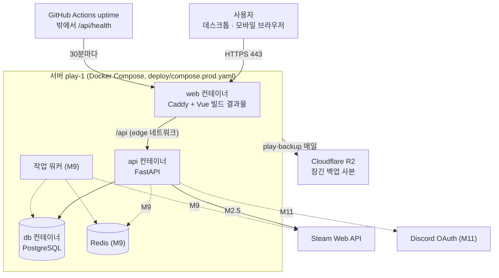
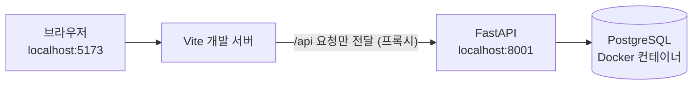
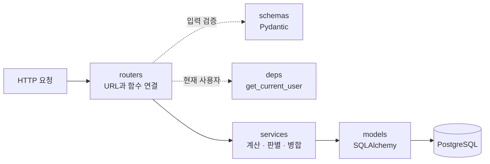
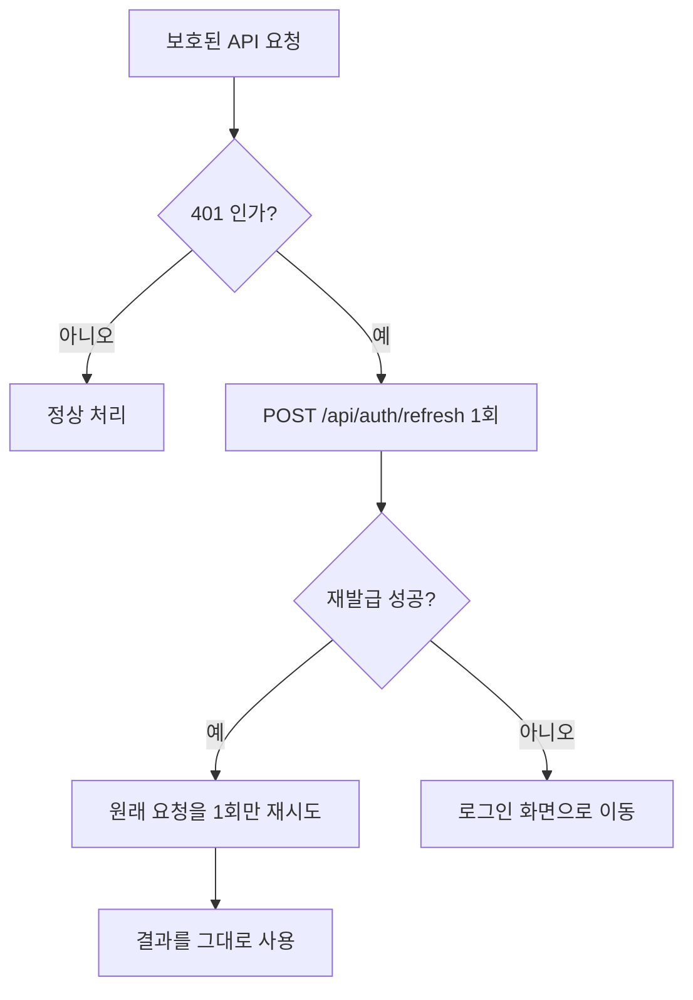
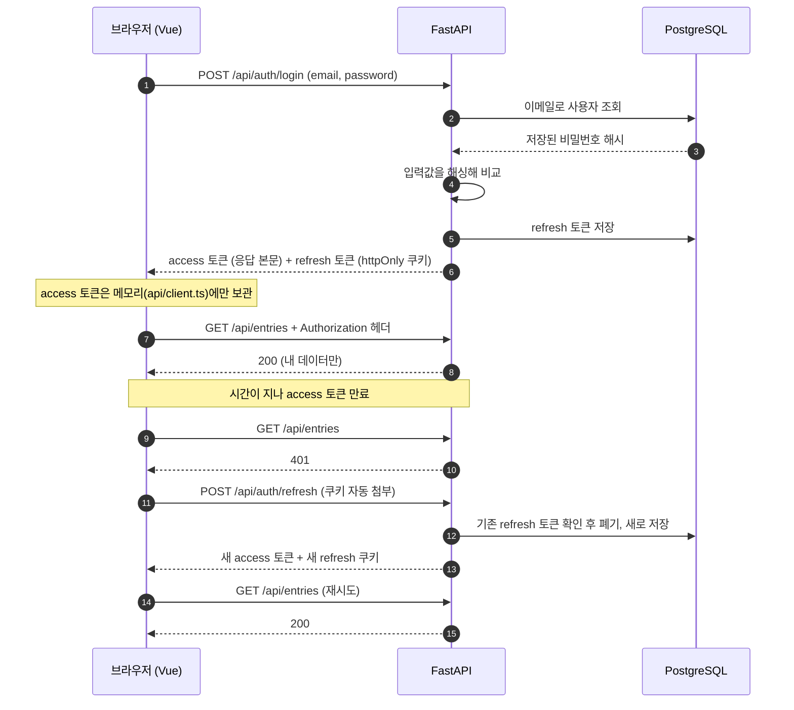
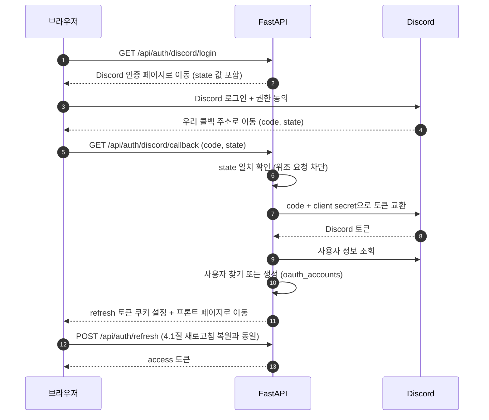
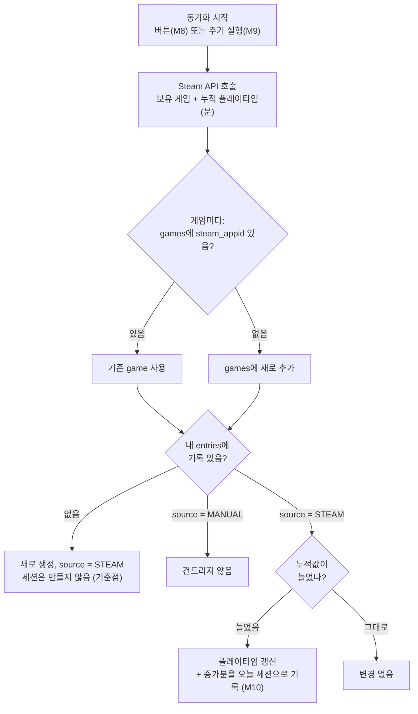
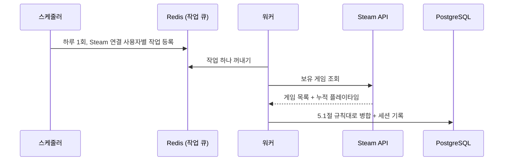
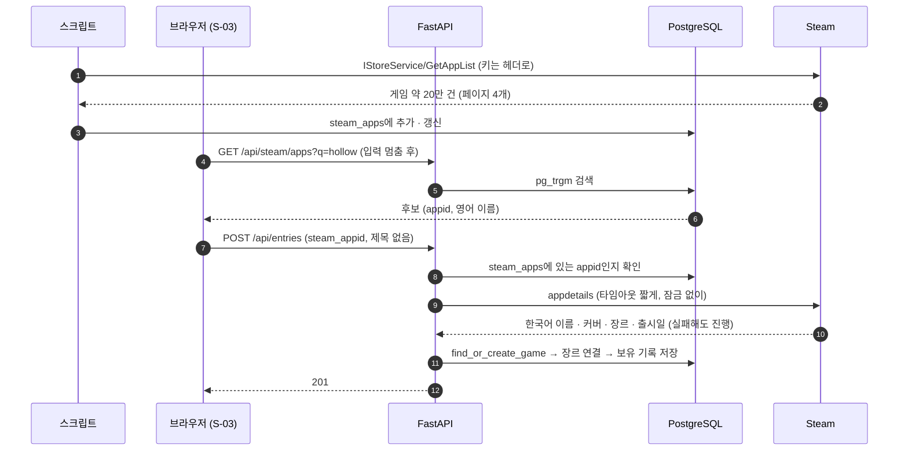

# PLAYLEDGER — 아키텍처

> **코드가 어떻게 나뉘고 요청이 어떻게 흐르는지**, API 계약(인증 · 에러 규칙), 인증 · 동기화 흐름, 개발 환경을 적는 문서다.
> 엔드포인트 목록은 Swagger(`/docs`), 스택을 고른 이유는 [decisions/](decisions/README.md), 데이터 구조는 [DATA_MODEL](DATA_MODEL.md).

---

## 1. 전체 구조

### 1.1 운영 환경



점선은 아직 없는 것이다. 포트를 여는 것은 `web`뿐이다. `api`는 `edge`(Caddy · Steam)와 `backend`(DB) 둘에 있고, `db`는 인터넷으로 나가는 길이 없는 `backend`에만 있다. 서버 세팅 · 타이머 · 백업은 [`SERVER`](SERVER.md).

### 1.2 개발 환경



**핵심 원칙: 화면은 표시만, 서버는 판단만.**

완주율, 시간당 비용 같은 계산은 전부 서버에서 한다. 방치일수만 사용자 시간대의 오늘이 기준이라 목록 카드는 화면이, 통계는 화면이 보낸 날짜로 서버가 계산한다.
프론트엔드는 받은 숫자를 표시할 뿐이다. 계산식이 바뀌어도 서버만 고치면 되고,
계산 로직을 pytest로 한 곳에서 검증할 수 있다.

**같은 출처(Same-Origin) 원칙**

운영에서는 Caddy가, 개발에서는 Vite 프록시가 화면과 API를 같은 주소 아래로 묶는다.
브라우저 입장에서 둘이 한 사이트처럼 보이므로 CORS 설정이 필요 없고,
refresh 토큰 쿠키도 추가 설정 없이 자동으로 첨부된다.

---

## 2. 컴포넌트별 역할

### 2.1 Vue 프론트엔드

| 항목 | 내용 |
|---|---|
| 역할 | 사용자 인터페이스 전담 |
| 하는 일 | 화면 그리기, 입력 받기, API 호출, access 토큰 메모리 보관 |
| 하지 않는 일 | 통계 계산, 중복 판별, 데이터 정규화 |

입력값 검증은 프론트에서도 하고 서버에서도 한다. 프론트 검증은
**사용자 편의**(즉시 피드백), 서버 검증(Pydantic)이 **실제 방어선**이다.
브라우저 코드는 누구나 개발자 도구로 우회할 수 있다.

### 2.2 FastAPI 서버 내부 구조



| 계층 | 역할 |
|---|---|
| `routers` | URL을 받아 알맞은 서비스 함수로 넘긴다. 로직을 직접 갖지 않는다 |
| `schemas` | 요청·응답 데이터의 모양과 검증 규칙 |
| `deps` | 요청마다 필요한 준비물 (DB 세션, 현재 사용자) |
| `services` | 계산식, 중복 판별, Steam 병합 등 실제 판단 |
| `models` | 테이블 정의 |

**계층을 나누는 이유**

계산 로직이 `routers`에 섞이면 HTTP 요청을 흉내 내야만 테스트할 수 있다.
`services`로 분리하면 "완주율 계산"을 함수 하나로 떼어 pytest로 검증할 수 있다.

**정규화 규칙은 `core`에 둔다**

이메일 · 게임 제목 정규화는 `schemas`(입력 검증)와 `services`(중복 판별)가 함께 쓴다.
`services`에 두면 `schemas`가 `services`를 가져다 쓰게 되어 의존 방향이 거꾸로 된다.
맨 아래 계층인 `core`에 두면 모든 계층이 아래 방향으로만 의존한다.
규칙은 한 곳에만 둔다. 같은 규칙이 두 곳에 있으면 한쪽만 바뀌었을 때
"가입은 되는데 로그인이 안 되는" 식의 어긋남이 생긴다.

**게임을 찾거나 만드는 입구는 하나다**

게임 등록 API, Steam 동기화(M8), 테스트 데이터 시드(M4)는 모두 `services`의 같은 함수를 거쳐 게임을 얻는다.
입구가 여러 개면 한 곳만 중복 판별을 빠뜨려도 공유 테이블 `games`에 중복이 쌓인다.
v0에서 관리자 화면이 정규화를 거치지 않아 같은 게임이 2행 생긴 것이 이 경우다.
나중에 별칭 조회(`DATA_MODEL` 5장)를 붙일 때도 이 함수 하나만 고치면 된다.

### 2.3 PostgreSQL

| 항목 | 내용 |
|---|---|
| 역할 | 데이터 영구 저장 |
| 접근 방식 | SQLAlchemy(async) 경유. 복잡한 집계 쿼리는 HeidiSQL에서 SQL을 먼저 검증한 뒤 옮긴다 |
| 구조 변경 | Alembic 마이그레이션으로만 변경. DB를 손으로 직접 고치지 않는다 |

### 2.4 Redis (M9 부터)

| 항목 | 내용 |
|---|---|
| 역할 | 작업 큐(자동 동기화 작업 대기열), Steam API 응답 캐시 |
| 저장 성격 | 사라져도 되는 데이터만. 영구 데이터는 PostgreSQL에만 저장 |

### 2.5 외부 서비스

| 서비스 | 역할 | 호출 주체 |
|---|---|---|
| Steam Web API | 게임 목록 미러(M2.5), 보유 게임과 누적 플레이타임(M8) | **서버와 워커만** |
| Steam 스토어 `appdetails` (비공식) | 고른 게임의 한국어 이름 · 커버 · 장르 · 출시일 (M2.5) | **서버만** |
| Discord OAuth | 외부 로그인 | **서버만** |
| Cloudflare R2 | 잠긴 DB 백업 사본 14일 (M5, [decisions/0013](decisions/0013-r2-offsite-backup.md)) | **서버의 `play-backup`만** (앱 코드는 부르지 않는다) |
| GitHub Container Registry · Actions | 운영 이미지 보관, 밖에서 하는 감시(`uptime`) | CI가 올리고 서버가 받는다 ([`SERVER`](SERVER.md) 1절) |

API 키와 클라이언트 시크릿은 서버 밖으로 나가지 않는다. 프론트엔드 코드는
브라우저로 전부 내려받아지므로, 여기에 넣은 값은 누구나 볼 수 있다.

---

## 3. API 계약

서버가 제공하는 API의 공통 규칙과 클라이언트가 지켜야 할 동작이다. **코드만 보고는 알 수 없는 약속**만 적는다.
엔드포인트 목록 · 요청 · 응답 스키마는 Swagger(`/docs`)가 원본이다. 코드가 바뀌면 Swagger는 따라오지만 문서는 따라오지 않으므로 여기에 옮기지 않는다.
인증 흐름의 설계 근거는 4.1절, 외부 API(Steam · Discord)를 호출하는 규약은 5장, 에러 문구가 화면에 어떻게 보이는지는 `DESIGN` 3장.

### 3.1 공통 규약

**기본 경로** · 모든 API는 `/api`로 시작한다. (1장 ─ Caddy · Vite 프록시가 이 접두사로 화면과 서버를 가른다)

**형식** · 요청 · 응답 본문은 JSON, 인코딩은 UTF-8이다.

**시각** · 모든 시각 값은 UTC 기준 ISO 8601 문자열로 표시된다. (예: `2026-09-23T04:49:29.739573Z`)
끝의 `Z`는 UTC를 의미한다. 화면에 표시할 때 사용자의 시간대로 변환하는 것은 클라이언트의 몫이다.
단, 날짜만 다루는 값(`purchased_at`)은 시각 없이 `2026-09-23` 형태이다.

**인증 정보를 붙이는 방법**

| 토큰 | 붙는 방법 | 붙는 범위 |
|---|---|---|
| access | `Authorization: Bearer {토큰}` 헤더를 **직접** 넣는다 | 넣은 요청에만 |
| refresh | 브라우저가 쿠키(`pl_refresh_token`)를 **자동으로** 붙인다 | `/api/auth` 아래 요청에만 |

refresh 쿠키의 범위가 좁은 것은 `Path=/api/auth`로 심었기 때문이다.
`/api/entries` 같은 요청에는 처음부터 첨부되지 않으므로, 그쪽에서 쿠키를 찾으면 없는 것이 정상이다.

**성공 응답 코드**

| 코드 | 사용되는 경우 | 예시 |
|---|---|---|
| 200 | 조회 · 수정 성공 | 목록, 단건, 로그인 |
| 201 | 새로 만들어짐 | 회원가입, 보유 기록 등록 |
| 204 | 성공한 요청은 맞으나 돌려줄 본문이 없음 | 로그아웃, 보유 기록 삭제 |

201과 204는 단순히 "성공"의 의미만을 담고 있는 200과는 달리 **무슨 일이 일어났는지**까지 알려준다.
등록 요청에 200이 오면 클라이언트가 이 요청이 새로 만들어진 요청인지 이미 존재하던 요청인지 구분할 수 없다.

**에러 응답의 공통 형태**

```json
{ "detail": "이미 등록된 게임입니다" }
```

`detail` 하나만 표기되고, 값은 **사용자에게 그대로 보여줄 수 있는 한국어 문장**이다.
에러 코드 번호나 영문 키를 따로 두지 않는다 ─ 화면이 코드를 문장으로 번역하는 표를
따로 관리하게 되면, 서버와 화면 두 곳에 문구가 흩어진다.

> 단, 422(입력 형식 오류)만 `detail`의 값이 문자열이 아니다. 3.9절 참고.
> 500도 같은 형태의 한국어 문장이고 원인은 서버 로그에만 남는다. 프록시가 만든 502 · 504처럼 `detail`을 읽지 못하는 응답에는 화면이 고정 문구를 보여 준다.

**공개 서버를 위한 응답**

| 코드 | 언제 | 비고 |
|---|---|---|
| 429 | 로그인 · 가입 · 기록 등록이 너무 잦음, 로그인 · 계정 삭제의 비밀번호가 너무 자주 틀림(둘이 같은 실패 횟수를 센다) | `Retry-After` 헤더. 메모리에 세므로 서버 한 대 기준이다 (`core/rate_limit.py`) |
| 403 | `/refresh` · `/logout`을 다른 사이트에서 부름 | 브라우저의 `Sec-Fetch-Site`로 판단. 형제 서브도메인은 SameSite로 막히지 않는다 |
| 403 | 계정 삭제의 비밀번호가 틀림 | 401이면 화면이 토큰 만료로 알고 재발급을 시도한다 |
| 503 | `/api/health`에서 DB에 닿지 못함 | 평소 응답 `{"status":"ok","database":"ok","disk":"ok"}`. `disk`는 `ok` · `low`(남은 공간 10% 미만) · `error`이고 상태 코드를 바꾸지 않는다 ─ 503이면 배포가 되돌리기를 시작하기 때문. 밖의 `uptime` 감시가 따로 본다 |

운영에서는 `ENABLE_DOCS=false`로 Swagger를 끈다.

### 3.2 토큰의 획득

로그인(`POST /api/auth/login`)과 재발급(`POST /api/auth/refresh`)은 동일한 형태로 응답한다.

```json
{ "access_token": "eyJhbGciOiJIUzI1NiIs...", "token_type": "bearer" }
```

refresh 토큰은 응답 본문에 포함되지 않으며, `Set-Cookie` 헤더로만 전달된다.
본문에 담으면 JavaScript가 읽을 수 있게 되어 `HttpOnly` 속성의 의미가 사라진다.

access 토큰은 메모리에만 보관한다. `localStorage` 등 영속 저장소에 기록하지 않는다.

### 3.3 401 응답의 처리



다음 4가지를 규칙으로 둔다.

**① 재발급은 1회만 시도한다.**
재발급에 성공한 뒤의 재시도에서 다시 401이 오면 더 이상 재발급하지 않고 로그인 화면으로 보낸다.

**② 인증 API 자체가 반환한 401은 재발급 대상이 아니다.**
`/api/auth/login`과 `/api/auth/refresh`의 401은 각각 자격 증명 오류와 세션 만료를 뜻한다.
이를 재발급으로 처리하면 요청이 스스로를 호출하는 순환이 발생한다.

**③ 재발급 요청은 동시에 두 번 이상 보내지 않는다.**
여러 요청이 동시에 401을 받더라도 재발급은 1번만 수행하고, 나머지는 그 결과를 기다린다.
refresh 토큰은 사용할 때마다 교체되므로(rotation), 동일한 토큰으로 동시에 두 번 요청하면
뒤늦게 도착한 쪽은 이미 폐기된 토큰을 제시한 것이 된다.
서버는 이를 **탈취 신호로 간주해 해당 사용자의 모든 토큰을 폐기**하며,
그 결과 정상 사용자가 로그아웃된다. (4.1절 재사용 감지)
탭 하나 안에서는 진행 중인 약속을 함께 기다리고, 탭 사이에서는 `navigator.locks`로 줄을 세운다.
앞 탭이 끝난 뒤 보내면 브라우저가 새 쿠키를 실어 보내므로 정상 교체가 된다. (두 탭 동시 새로고침: 잠금 없이 3번째에 로그아웃, 잠금으로 10번 유지. 2026-11-04)

**④ 분기의 판단은 상태 코드와 요청 경로로만 한다.**
응답의 `detail` 문구는 사용자에게 표시하기 위한 값이며, 조건 분기의 기준으로 삼지 않는다.
문구가 수정되는 순간 동작이 함께 바뀌기 때문이다.

### 3.4 로그인 상태의 복원

access 토큰은 메모리에만 존재하므로 새로고침하면 사라진다.
앱을 시작할 때 `POST /api/auth/refresh`를 먼저 호출해 토큰을 복원한다.

이때의 401은 오류가 아니라 **로그인하지 않은 상태**를 의미한다.
에러 문구를 표시하지 않고 비로그인 상태로 시작한다.
401이 아닌 실패(서버에 닿지 못함 · 5xx)는 로그인 여부를 모르는 것이라, 로그인 화면에 경고와 "다시 시도"를 띄운다 (`stores/auth.ts`의 `restoreFailed`).

### 3.5 로그아웃

`POST /api/auth/logout`은 쿠키의 유무와 관계없이 항상 204로 응답한다. (멱등)
클라이언트는 응답을 기다리되 그 결과와 무관하게 메모리의 access 토큰과 로그인 상태를 초기화한다.

### 3.6 상태 코드 사용 기준

| 코드 | 의미 | 사용하는 경우 |
|---|---|---|
| 401 | 인증 실패 | 자격 증명 오류, 토큰 없음 · 만료 · 위조 |
| 404 | 대상 없음 | 존재하지 않거나, **내 것이 아닌** 리소스 |
| 409 | 상태 충돌 | 요청 형식은 옳으나 현재 데이터와 어긋남 |
| 422 | 값 오류 | 요청 값이 규칙을 만족하지 않음 |
| 500 | 서버 오류 | 예상치 못한 실패. 다른 코드로 가리지 않는다 |

남의 기록에는 403을 쓰지 않는다(3.8절). 403을 쓰는 곳은 3.1절 표의 두 경우뿐이다.

400 대신 409를 사용하는 기준은 **요청 자체가 잘못됐는가, 서버의 현재 상태와 부딪혔는가**이다.
이미 가입된 이메일로 다시 가입하는 요청은 형식상 아무 문제가 없다. 동일한 요청이라도
그 이메일이 아직 비어 있었다면 성공했을 것이므로, 잘못된 것은 요청이 아니라 타이밍이다.

### 3.7 401이 발생하는 네 지점

| 문구 | 발생 지점 | 함께 일어나는 현상 |
|---|---|---|
| `인증이 필요합니다` | 보호된 모든 API (`get_current_user`) | `WWW-Authenticate: Bearer` 헤더 동반 |
| `이메일 또는 비밀번호가 올바르지 않습니다` | `POST /api/auth/login` | 존재하지 않는 계정에도 해시 검증을 1회 수행하여 응답 시간을 맞춘다 |
| `인증 정보가 없습니다` | `POST /api/auth/refresh` ─ 쿠키 없음 | 없음 |
| `다시 로그인해 주세요` | `POST /api/auth/refresh` ─ 폐기 · 만료 · 미등록 토큰 | **refresh 쿠키가 함께 삭제된다** |

세 번째와 네 번째가 나뉘어 있는 것은 의도된 설계이다.
"쿠키를 보내지 않았다"는 요청자가 이미 알고 있는 사실이므로 알려주어도 정보가 새어나가지 않는다.
반면 네 번째를 "만료됨 / 폐기됨 / 존재하지 않는 토큰"으로 세분하면,
공격자가 훔친 토큰의 상태를 서버에 물어볼 수 있게 된다.

### 3.8 404를 사용하고 403을 사용하지 않는 이유

다른 사용자의 리소스에 접근하면 403(권한 없음)이 아니라 404(없음)로 응답한다.

403은 "그 리소스는 존재하지만 권한이 없다"는 의미이다.
이 응답은 요청자에게 **해당 id의 데이터가 실재한다는 사실**을 알려준다.
id를 1부터 차례로 요청하면 전체 기록의 개수와 분포를 추측할 수 있다.

내 것이 아닌 기록은 처음부터 존재하지 않는 것처럼 보여야 한다.
조회 · 수정 · 삭제 모두 동일하게 404 `기록을 찾을 수 없습니다`로 응답한다.
DB integer 범위를 넘는 id(0 · 음수 · 2147483648 이상)도 DB에 묻지 않고 같은 404로 답한다. 주소창에 아무 숫자나 칠 수 있어서다 (2026-11-03 전에는 500).

> 이 규칙은 자동 테스트로 검증한다. (`tests/test_entry_isolation.py` · 범위 밖 id는 `tests/test_entry_detail.py`)

> `HTTPBearer`의 기본 동작은 403이다. `auto_error=False`로 끄고 401을 직접 던져 이 규칙을 지킨다.

### 3.9 422 본문의 형태

422의 본문은 2가지 형태이다.
동일한 422라도 누가 생성했는지에 따라 `detail`의 자료형이 다르다.

**① Pydantic 생성 형태** ─ 타입 · 길이 · 범위 위반. `detail`이 **배열**이다.

```json
{
  "detail": [
    {
      "type": "string_too_short",
      "loc": ["body", "password"],
      "msg": "String should have at least 8 characters"
    }
  ]
}
```

**② 서버 생성 형태** ─ 형식은 맞으나 값이 실재하지 않는 경우. `detail`이 문자열이다.

```json
{ "detail": "존재하지 않는 장르가 포함되어 있습니다" }
```

클라이언트는 422를 받으면 **`detail`의 자료형을 먼저 확인해야 한다.**
문자열이면 그대로 표시하고, 배열이면 각 항목의 `loc`으로 어느 입력란인지 찾아
폼 아래 한 줄에 칸 이름을 모아 보여 준다(`lib/entry-form.ts`의 `issuesMessage`). 자료형 확인 없이 그대로 표시하면
배열인 경우 사용자에게 `[object Object]`의 형태로 보여진다.

`msg`는 영문이며 사용자에게 보여줄 문장이 아니다.
화면에 표시할 한국어 문구는 `loc`으로 입력란을 특정한 뒤 클라이언트가 결정한다.

Pydantic 기본 응답의 `input` · `ctx`는 내보내지 않는다. `input`에 보낸 비밀번호가 그대로 담기고, 깨진 글자가 있으면 응답을 만들다 500이 된다 (`main.py`).

### 3.10 문구를 합치는 기준과 나누는 기준

**합친다** ─ 구분하여 알리는 것이 요청자에게 새로운 정보가 되는 경우.
로그인 실패(계정 없음 / 비밀번호 오류)와 재발급 실패(폐기 / 만료 / 미등록)가 여기 해당된다.
문구뿐 아니라 **응답 시간과 상태 코드까지** 같아야 한다. 셋 중 하나라도 갈리면 구분이 가능해진다.

**나눈다** ─ 사용자가 그 정보를 받아 행동을 바꿀 수 있는 경우.
`이미 등록된 게임입니다`와 `존재하지 않는 장르가 포함되어 있습니다`가 그렇다.
무엇을 고쳐야 하는지 알려주지 않으면 사용자는 같은 실패를 반복한다.

> **예외** · 회원가입의 `이미 사용 중인 이메일입니다` 문구는 계정 존재 여부를 노출한다.
> 이를 막기 위해서는 가입을 항상 성공으로 응답하고 메일로 안내해야 하므로 v1.0 범위를 벗어난다.
> 로그인은 위 기준으로 막아놓았다. 완전 차단은 `REQUIREMENTS` 4.4절 F-27 참고.

---

## 4. 인증 흐름

### 4.1 로그인과 토큰 재발급



| 토큰 | 수명 | 보관 위치 | 이유 |
|---|---|---|---|
| access | 짧게 (분 단위) | 브라우저 메모리 | 탈취돼도 금방 만료 |
| refresh | 길게 (일 단위) | httpOnly 쿠키 + DB | JS가 읽을 수 없어 XSS로 탈취 불가, DB에서 폐기 가능 |

**localStorage에 저장하지 않는 이유**

localStorage는 페이지의 모든 JS가 읽을 수 있다. 악성 스크립트가 한 줄만
끼어들어도 토큰이 통째로 빠져나간다.

**새로고침해도 로그인이 유지되는 원리**

새로고침하면 메모리의 access 토큰은 사라진다. 앱이 시작될 때
`/api/auth/refresh`를 먼저 호출하면, 쿠키의 refresh 토큰으로
새 access 토큰을 받아 로그인 상태가 복원된다.

**refresh 쿠키 속성**

`HttpOnly`(JS 접근 차단) · `Secure`(HTTPS에서만 전송) · `SameSite=Strict`(다른 사이트에서 시작된 요청엔 첨부 안 함) · `Path=/api/auth`(인증 API에만 첨부).
로그아웃 시 DB의 refresh 토큰을 폐기하고 쿠키를 삭제한다.

**refresh 토큰을 매번 교체하는 이유 (rotation)**

재발급할 때마다 기존 refresh 토큰을 폐기하고 새로 발급한다.
누군가 옛 토큰을 훔쳐 쓰려 해도 이미 폐기된 뒤다.

**폐기된 토큰이 다시 들어오면 (재사용 감지)**

rotation을 거친 토큰은 정상 흐름에서는 두 번 쓰일 일이 없다.
이미 폐기된 refresh 토큰이 다시 들어온다는 것은, 누군가 옛 토큰을
훔쳐 쓰고 있다는 신호다. 이때는 그 요청만 거절하는 것으로 부족하다.
공격자가 이미 새 토큰을 받아 갔을 수 있으므로, **해당 사용자의 살아 있는
refresh 토큰을 전부 폐기하고** 쿠키를 삭제한 뒤 401을 반환한다. 사용자도 함께 로그아웃되지만,
다시 로그인하면 공격자의 토큰만 죽은 상태로 남는다. (`DATA_MODEL` 2.2절)

### 4.2 사용자별 데이터 격리

세 겹으로 막는다.

1. **의존성** — 모든 보호된 API는 `get_current_user`를 거쳐야 실행된다
2. **함수 시그니처** — `services`의 조회 함수는 `user_id`를 필수 인자로 받는다. 빠뜨리면 조용히 새는 대신 실행 즉시 에러가 나고, 이는 3번 테스트에서 잡힌다
3. **자동 테스트** — "A 계정의 기록이 B 계정에 안 보임"을 pytest로 매 push마다 검증한다

### 4.3 Discord 로그인 (M11)



Discord가 주는 것은 "이 사람이 Discord의 몇 번 사용자다"라는 확인뿐이다.
콜백은 fetch 응답이 아니라 브라우저 페이지 이동이므로 access 토큰을 본문으로
돌려줄 수 없다. 그래서 refresh 쿠키만 심고 프론트로 보낸 뒤,
4.1절의 새로고침 복원 방식으로 access 토큰을 받는다.

---

## 5. Steam 동기화 흐름

### 5.1 병합 규칙 (M8, M10)



동기화가 끝나면 "추가 N개 · 갱신 M개 · 변경 없음 K개"를 반환한다.

**처음 가져올 때 세션을 만들지 않는 이유**

첫 동기화 시점의 누적값(예: 300시간)은 "지금까지의 전부"이지 "오늘 한 것"이 아니다.
이를 세션으로 기록하면 히트맵에 하루 300시간이 찍힌다. 첫 값은 기준점으로만
저장하고, 다음 동기화부터 증가분을 세션으로 만든다.

### 5.2 자동 동기화 (M9)



**API 서버가 아니라 워커가 하는 이유**

사용자 수만큼 Steam을 호출하는 작업을 API 서버가 직접 하면,
그동안 들어오는 화면 요청이 밀린다. 할 일을 큐에 적어두고
별도 워커가 하나씩 처리하면 API 서버는 요청 응답에만 집중할 수 있다.

### 5.3 Steam 검색 등록 (M2.5)



- **외부 호출은 DB 잠금을 잡기 전에 한다.** Steam이 느릴 때 게임 행을 잠근 채 기다리면 같은 게임을 등록하는 다른 사용자까지 멈춘다
- **보유 기록의 `source`는 `MANUAL`이다.** `STEAM`이면 M8 동기화가 사용자가 입력한 플레이타임을 덮어쓴다(5.1절). 게임이 Steam에 있는지는 `games.steam_appid`가 말한다
- 등록 요청은 `title` 또는 `steam_appid` 중 정확히 하나만 받는다
- 미러링은 `server/`에서 `python -m app.scripts.sync_steam_apps`로 손으로 돌린다 (M9 전까지). 테이블이 비어 있어도 직접 입력은 된다

---

## 6. 프로젝트 구조

```
playledger/
│
├── server/                     # FastAPI
│   ├── app/
│   │   ├── main.py             # 앱 시작점
│   │   ├── core/               # 설정, DB 연결, 보안 (JWT · 해싱), 정규화 규칙
│   │   ├── models/             # SQLAlchemy 테이블 정의
│   │   ├── schemas/            # Pydantic 요청·응답 모양
│   │   ├── routers/            # URL ↔ 함수 연결
│   │   ├── services/           # 계산 · 중복 판별 · 병합
│   │   ├── deps.py             # 현재 사용자, DB 세션
│   │   ├── scripts/            # 손으로 돌리는 작업 (Steam 게임 목록 미러링)
│   │   └── workers/            # 작업 큐 작업 (M9)
│   ├── alembic/                # 마이그레이션 이력
│   ├── tests/
│   ├── requirements.txt
│   └── .env.example
│
├── web/                        # Vue 3
│   ├── src/
│   │   ├── api/                # API 호출 모듈 (토큰 첨부 · 401 재시도) · 엔드포인트별 호출 함수
│   │   ├── lib/                # 화면과 무관한 순수 규칙 (테마 판정 · 카드 표시 변환) + shadcn-vue 유틸
│   │   ├── composables/        # 화면 하나가 쓰는 상태 · 불러오기 (예: 목록 20개씩 추가 로드)
│   │   ├── stores/             # Pinia ─ 앱 전체가 공유하는 상태만 (로그인 · 테마)
│   │   ├── router/             # Vue Router · 로그인 가드
│   │   ├── views/              # 페이지 단위 화면
│   │   └── components/         # 재사용 UI 조각
│   │       └── ui/             # shadcn-vue 컴포넌트 모음 (직접 수정 가능)
│   ├── package.json
│   └── vite.config.ts          # 개발용 /api 프록시 설정
│
├── .github/workflows/          # ci.yml(pytest · 화면 검사 · 이미지 · audit), uptime.yml(운영 감시)
├── deploy/                     # 운영 Compose · 서버 스크립트 · systemd 타이머 (SERVER)
├── scripts/                    # PC 쪽 배포(task deploy) · 200개 측정
├── Taskfile.yml
├── LICENSE
├── docker-compose.yml          # 개발용 PostgreSQL만 (운영은 deploy/compose.prod.yaml, M9에 Redis)
├── .env.example                # Compose용 DB 계정 키 이름 (값은 루트 .env)
├── docs/
├── .gitattributes              # 줄바꿈 규칙 (LF 고정)
├── .gitignore
└── README.md
```

**API 호출을 `api/` 모듈로 모으는 이유**

화면마다 직접 호출하면 토큰 첨부 방식이나 "401이면 재발급 후 재시도" 규칙이 바뀔 때 모든 화면을 고쳐야 한다. 한 곳에 모아두면 그 파일만 고치면 된다. PulseGrid에서 수집기 설정을 `config.json`으로 분리한 것과 같은 발상이다.

---

## 7. 설정 및 비밀값 관리

| 항목 | 보관 위치 | Git 추적 |
|---|---|---|
| DB 컨테이너 계정 (사용자명 · 비밀번호 · DB명) | 루트 `.env` | X |
| JWT 서명 키 | `server/.env` | X |
| DB 접속 정보 | `server/.env` | X |
| Redis 주소 | `server/.env` | X |
| Steam API 키 (`STEAM_API_KEY`, 미러링 스크립트만 씀. 없어도 서버는 뜬다) | `server/.env` | X |
| Discord Client Secret | `server/.env` | X |
| 프론트 설정 | `web/.env` | 필요 시 |

`.env.example`에 키 이름만 적고 값은 비워서 커밋한다.
위 표는 개발 기기 기준이다. 운영 서버의 `.env` · `r2.env` · 백업 공개키, PC에만 있는 백업 개인키는 [`SERVER`](SERVER.md) 3.6 · 3.7 · 3.9절.

**루트 `.env`가 따로 있는 이유**

Docker Compose는 `docker-compose.yml`과 같은 폴더의 `.env`를 자동으로 읽어 설정의 빈칸을 채운다.
`server/.env`를 컨테이너에 통째로 넘기는 방법(`env_file`)도 있지만, 그러면 DB 컨테이너가
쓰지도 않는 JWT 서명 키 · Steam API 키까지 받게 된다. 그래서 DB 계정만 루트 `.env`로 분리한다.

대신 같은 비밀번호가 루트 `.env`(컨테이너를 만들 때)와 `server/.env`의 `DATABASE_URL`(서버가 접속할 때)
두 곳에 들어간다. 둘이 어긋나면 서버가 DB에 접속하지 못하므로, **비밀번호를 바꿀 땐 두 파일을 함께 고친다.**

**`web/.env`에는 비밀값을 절대 넣지 않는다.**
Vite는 `VITE_`로 시작하는 환경변수를 빌드 결과물 JS에 그대로 박아 넣는다.
즉 브라우저로 내려가서 누구나 볼 수 있다. 비밀값은 `server/.env`와 루트 `.env`에만 둔다.

---

## 8. 확장 고려사항

| 항목 | 대응 |
|---|---|
| 다른 외부 로그인 추가 | `oauth_accounts.provider` 값만 추가. 스키마 변경 불필요 |
| 동기화 대상 사용자 증가 | 워커 컨테이너 수만 늘리면 됨 (큐가 작업을 나눠줌) |
| 모바일 앱 필요 시 | 계산이 서버에 있으므로 API 그대로 재사용 |
