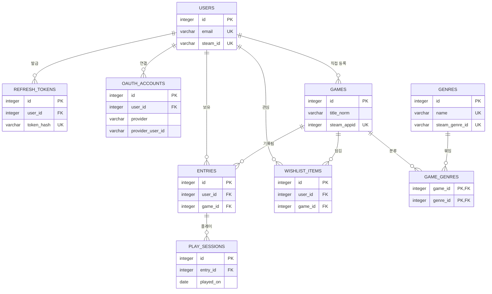

# PLAYLEDGER — 데이터 모델

> **무엇을 어디에 왜 저장하는지**와 관계도를 적는 문서다.
> 구현된 테이블의 컬럼 · 제약은 `server/app/models/`와 `server/alembic/versions/`가 원본이고, 아직 구현 전인 테이블(2.3 · 2.7 · 2.8절)만 이 문서가 원본이다. 코드가 생기면 그때 문서에서 뺀다.

---

## 1. 전체 구조



> 다이어그램에는 관계 파악에 필요한 키만 표시한다. 전체 컬럼은 모델 · 마이그레이션이 기준이다 (구현 전 테이블은 2장 표).

### 테이블 역할

| 테이블 | 역할 |
|---|---|
| `users` | 사용자 계정. Discord로만 가입한 계정은 비밀번호가 없음 |
| `refresh_tokens` | 발급한 refresh 토큰 (로그아웃 · 강제 만료용) |
| `oauth_accounts` | 외부 로그인 연결 (provider, provider_user_id) *(구현 전, M11)* |
| `games` | 게임 마스터 데이터 (제목, 정규화 제목, steam_appid, 직접 등록한 사람) |
| `genres` | 장르 |
| `game_genres` | 게임-장르 다대다 연결 |
| `entries` | 사용자별 보유 기록 (구매일, 구매가, 상태, 평점, 플레이타임) |
| `wishlist_items` | 사용자별 위시리스트 *(구현 전, M7)* |
| `play_sessions` | 보유 기록별 날짜 단위 플레이 기록 *(구현 전, M10)* |
| `steam_apps` | Steam 게임 목록 미러. 검색 전용이라 다른 테이블과 관계가 없다 (2.9절) |

### 관계 요약

| 관계 | 종류 | 의미 |
|---|:---:|---|
| USERS → ENTRIES | 1:N | 사용자 1명이 보유 기록 여러 개를 가진다 |
| USERS → WISHLIST_ITEMS | 1:N | 사용자 1명이 관심 게임 여러 개를 가진다 |
| USERS → GAMES | 1:N | 직접 등록한 게임의 주인. Steam 게임은 주인이 없다 |
| USERS → REFRESH_TOKENS | 1:N | 기기·브라우저마다 로그인 토큰이 따로 발급된다 |
| USERS → OAUTH_ACCOUNTS | 1:N | 외부 로그인 서비스별로 하나씩 연결된다 |
| GAMES → ENTRIES / WISHLIST_ITEMS | 1:N | 게임 1개가 여러 사용자의 기록·위시리스트에 등장한다 |
| GAMES ↔ GENRES | N:M | 게임 1개에 장르 여러 개, 장르 1개에 게임 여러 개 |
| ENTRIES → PLAY_SESSIONS | 1:N | 보유 기록 1개에 날짜별 플레이 기록 여러 개 |

---

## 2. 테이블 상세

구현된 테이블의 컬럼 · 타입 · 제약은 `server/app/models/`와 `server/alembic/versions/`가 원본이라 옮기지 않는다. 여기에는 코드만 봐서는 알 수 없는 이유만 적는다. 구현 전 테이블(2.3 · 2.7 · 2.8절)은 이 문서가 원본이고, 모델이 생기면 컬럼 표를 뺀다.

### 2.0 공통 규칙

| 항목 | 규칙 | 이유 |
|---|---|---|
| 시각 | `timestamptz` | 시간대 정보를 함께 저장하고, 화면에 표시할 때 한국 시간으로 변환한다 |
| 코드값 | `varchar` + `CHECK` | PostgreSQL ENUM 타입은 값 추가 시 마이그레이션이 번거롭다 |
| 외부 서비스 ID | 문자열 | Steam·Discord ID는 64비트 정수라 JS 숫자로 다루면 끝자리가 깨진다 |
| `updated_at` 갱신 | ORM(SQLAlchemy)에서 처리 | PostgreSQL에는 MariaDB의 `ON UPDATE CURRENT_TIMESTAMP`가 없다 |
| 값 범위 | DB의 `CHECK`로 강제 | 서버 코드를 거치지 않는 경로(직접 SQL 등)로도 잘못된 값이 들어갈 수 없게 한다 |

**외래키 삭제 규칙**

| 부모 삭제 시 | 자식 테이블 | 규칙 |
|---|---|---|
| 사용자 삭제 | `refresh_tokens`, `oauth_accounts`, `entries`, `wishlist_items`, `games`(직접 등록) | CASCADE (함께 삭제). `entries.game_id`가 RESTRICT라 계정 삭제는 기록 → 게임 → 계정 순서로 지운다 (`services/auth.py`) |
| 보유 기록 삭제 | `play_sessions` | CASCADE |
| 게임 삭제 | `entries`, `wishlist_items` | RESTRICT (참조 중이면 삭제 거부) |
| 게임·장르 삭제 | `game_genres` | CASCADE |

### 2.1 `users`

컬럼은 `server/app/models/user.py`.

비밀번호로 로그인하는 계정은 반드시 이메일이 있어야 한다.

**email을 소문자로 정규화하는 이유**

`Test@a.com`과 `test@a.com`이 서로 다른 계정으로 가입되면 안 된다.
`title_norm`과 같은 원리로, 저장 경로와 무관하게 서버가 항상 소문자로 바꿔 저장한다.

**`steam_id`가 UNIQUE인 이유**

두 계정이 같은 Steam ID를 연결하면, 한 사람의 라이브러리가 두 계정에 복제된다.

### 2.2 `refresh_tokens`

컬럼은 `server/app/models/user.py`.

**원문이 아니라 해시를 저장하는 이유**

비밀번호와 같다. DB가 유출돼도 해시만으로는 로그인할 수 없다.
요청으로 들어온 토큰을 해싱해서 `token_hash`와 비교한다.

**지우지 않고 `revoked_at`을 기록하는 이유**

rotation으로 폐기된 토큰이 다시 들어온다면, 누군가 옛 토큰을 훔쳐 쓰고 있다는 신호다.
폐기 기록이 남아 있어야 이를 알아채고 해당 사용자의 토큰을 전부 폐기할 수 있다.

### 2.3 `oauth_accounts` *(구현 전, M11)*

| 컬럼 | 타입 | 제약 | 설명 |
|---|---|---|---|
| `id` | integer | PK | |
| `user_id` | integer | FK → users.id, NOT NULL | |
| `provider` | varchar(20) | NOT NULL, CHECK | `DISCORD` |
| `provider_user_id` | varchar(32) | NOT NULL | 해당 서비스의 사용자 ID |
| `created_at` | timestamptz | NOT NULL | 연결 시각 |

`(provider, provider_user_id)` 복합 UNIQUE — 같은 Discord 계정이 두 사용자에게 연결될 수 없다.
`(user_id, provider)` 복합 UNIQUE — 한 사용자는 서비스별로 계정 하나만 연결한다.

### 2.4 `games`

게임 자체의 정보. **Steam 게임은 모든 사용자가 공유**한다. 사용자가 몇 명이든 Steam의 사이버펑크 2077은 이 테이블에 한 행만 존재한다.
직접 등록한 게임은 만든 사람의 것이라 같은 제목이어도 사람마다 행이 따로다 ([decisions/0011](decisions/0011-manual-games-per-user.md)).

컬럼은 `server/app/models/game.py`. `title`은 화면에 표시할 제목, `title_norm`은 서버가 항상 계산하는 중복 판별용 값이다.

`title_norm`에는 수동 등록 게임(`steam_appid IS NULL`)끼리만 부분 UNIQUE가 걸려 있다.
수동 등록 게임끼리는 정규화된 제목이 겹칠 수 없다. 이유는 아래 "수동 등록 게임에만 UNIQUE를 거는 이유" 참고.

**`title`과 `title_norm`을 나누는 이유**

같은 게임이 여러 표기로 입력될 수 있다.

| 입력값 | `title_norm` |
|---|---|
| `사이버펑크 2077` | `사이버펑크2077` |
| `Cyberpunk 2077` | `cyberpunk2077` |
| `사이버펑크2077` | `사이버펑크2077` |
| `Baldur's Gate 3` | `baldursgate3` |
| `ＦＩＮＡＬ ＦＡＮＴＡＳＹ Ⅶ` | `finalfantasyvii` |

**정규화 규칙**

아래 네 단계를 순서대로 모두 거친다. 앞 단계의 결과가 다음 단계의 입력이 된다.

| 단계 | 처리 | 잡는 것 |
|:---:|---|---|
| 1 | 유니코드 정규화 (NFKC) | 전각 `ＦＦ７` → `FF7`, 로마숫자 기호 `Ⅶ` → `VII`, 분리형 한글 → 조합형 |
| 2 | 대소문자 통일 (`casefold`) | `Gate` / `gate`. `lower()`가 못 잡는 문자(`ß` → `ss`)까지 포함 |
| 3 | 글자 · 숫자만 남김 (`isalnum`) | 공백, `'`, `:`, `®`, `™`, 이모지 등 |
| 4 | 결과 검사 | 빈 문자열이거나 200자를 넘으면 거부 (422) |

4단계가 필요한 이유는 두 가지다. 제목이 `!!!`처럼 기호뿐이면 결과가 빈 문자열이 되어
그런 게임끼리 모두 같은 게임으로 판정된다. 또 1 · 2단계는 글자 수를 늘릴 수 있어(`Ⅶ` → `VII`),
제목이 200자 이내여도 `title_norm`이 컬럼 길이를 넘을 수 있다.

중복 여부는 항상 `title_norm`으로 판별하고, 화면에는 `title`을 보여준다.

> 이 규칙이 잡는 것은 **같은 글자를 다르게 쓴 경우**뿐이다.
> 뜻이 같은 다른 표기(`7` / `VII`, `사이버펑크` / `Cyberpunk`)는 정규화해도 서로 다른 값이 된다.
> 이를 규칙으로 해결하려 하면 `Mega Man X`가 `Mega Man 10`과 합쳐지는 것처럼 다른 게임을 합치는 실수가 생기므로,
> 5장의 별칭 테이블과 `REQUIREMENTS` F-23 · F-30으로 보완한다. (PartScope의 `model_aliases`와 같은 문제)

**중복 판별 순서**

1. `steam_appid`가 있으면 그것으로 비교 (가장 정확)
2. 없으면 **내가 직접 등록한** 게임(`owner_user_id`가 나, `steam_appid IS NULL`) 중에서 `title_norm`으로 비교
3. 둘 다 일치하지 않으면 새 게임으로 등록
4. 3에서 UNIQUE에 걸리면 (같은 게임이 방금 먼저 등록됨) 그 행을 다시 조회해 재사용

직접 등록한 게임은 만든 사람만 보고 쓴다. 공유하는 것은 Steam 게임뿐이다 ([decisions/0011](decisions/0011-manual-games-per-user.md)).
기록을 지우면 내 게임 행도 함께 지워지고, 2단계에서 게임 행을 잠가 지우는 요청과 섞이지 않게 한다.

판별은 `services`의 게임 조회 함수 한 곳에서만 한다. (`ARCHITECTURE` 2.2절)

**수동 등록 게임에만 UNIQUE를 거는 이유**

조회(2)와 등록(3) 사이에 같은 제목의 요청이 끼어들면, 둘 다 "없음"을 보고 각각 등록해 같은 게임이 두 행이 된다.
`users.email`의 UNIQUE가 회원가입에서 같은 틈을 막는 것과 같은 원리로, DB가 마지막 방어선이 된다.
이 제약은 2단계가 이미 하는 재사용을 동시 요청에서도 지키게 할 뿐, 새로 합쳐지는 게임은 없다.

범위는 `(owner_user_id, title_norm) WHERE steam_appid IS NULL`이다. 한 사람 안에서만 겹치지 않으면 된다.
Steam 게임은 `steam_appid` UNIQUE로 이미 식별되고, appid가 다른데 정규화 제목이 같은 게임(리메이크 등)이 있을 수 있어 제외한다.
CHECK `owner_only_manual`이 "직접 등록 = 주인 있음, Steam = 주인 없음"을 DB에서 지킨다.
`(title_norm, steam_appid)` 복합 UNIQUE로는 막을 수 없다. UNIQUE는 NULL끼리를 서로 다른 값으로 보므로, `steam_appid`가 NULL인 수동 게임끼리는 충돌하지 않는다.
2단계의 조회 범위도 같은 이유로 수동 등록 게임으로 한정한다. 범위가 부분 UNIQUE와 같아 결과는 많아야 한 행이다.
Steam 게임까지 포함하면 같은 제목이 여러 행일 수 있어 어느 것을 쓸지 정할 수 없다. 수동 게임과 Steam 게임은 합치지 않고 별개 행으로 둔다 ([decisions/0009](decisions/0009-manual-steam-separate.md)).

**Steam 게임이 받는 값** (M2.5, [decisions/0008](decisions/0008-steam-app-mirror.md))

`appdetails`(`l=koreana`)에서 받아 게임을 처음 만들 때 채운다. 실패해도 등록은 성공한다.

| 컬럼 | 값 | 받지 못하면 |
|---|---|---|
| `title` | 한국어 이름 | `steam_apps`의 영어 이름 |
| `cover_url` | `header_image` 주소 | NULL. 다음 사람이 같은 게임을 등록할 때 채운다 |
| `released_at` | `2017년 2월 24일` 형식만 날짜로 읽는다 | NULL. `coming_soon`, `Q1 2027` 같은 값도 NULL이고 등록은 성공한다 |

**`cover_url`을 계산하지 않고 저장하는 이유**

해시 없는 `header.jpg` 주소는 PEAK(3527290)처럼 404인 게임이 있다. 저장한 주소도 해시가 바뀌면 깨질 수 있어, 화면은 이미지 실패 시 제목 앞 두 글자로 대체한다.

### 2.5 `genres` / `game_genres`

장르는 게임과 다대다(N:M) 관계이므로 연결 테이블이 필요하다.

**`genres`**

컬럼은 `server/app/models/game.py`.

**장르 목록 (고정)**

목록의 원본은 시드 마이그레이션 `server/alembic/versions/20260921_1619_seed_genres.py`다. 8개: 액션 · 전략 · RPG · 캐주얼 · 레이싱 · 스포츠 · 어드벤처 · 시뮬레이션.

> ID와 표기는 Steam 스토어 API(`appdetails`, `l=koreana`)의 응답으로 확인했다 (2026-09-21).

사용자는 이 목록에서 고르기만 하고 새 장르를 만들 수 없다.

**고정 목록인 이유**

`genres`는 모든 사용자가 공유하는 마스터 데이터다. 사용자가 장르를 직접 입력하게 하면
`RPG` / `rpg` / `롤플레잉`이 서로 다른 행으로 쌓여, 장르별 통계(F-11)가 조용히 틀린다.
또 장르가 잘게 쪼개지면 장르마다 게임이 한두 개뿐이라, 게임 하나의 클리어 여부에 따라 완주율이 크게 달라진다.
칸이 적고 고정돼 있어야 통계가 의미를 갖는다.

**Steam 장르 중 8개만 쓰는 이유**

Steam 스토어 장르 중 **게임의 종류**를 나타내는 것만 골랐다.
`인디`(23) · `무료 플레이`(37) · `대규모 멀티플레이어`(29)는 각각 제작 규모 · 가격 모델 · 플레이 방식이라
다른 장르와 전부 겹치고, 해당 장르의 완주율이 무엇을 뜻하는지 불분명해 제외했다.
오픈월드 · 로그라이크 같은 세부 분류는 Steam에서 장르가 아니라 사용자 태그라 포함하지 않는다.

**`steam_genre_id`를 두는 이유**

M8 Steam 동기화 때 Steam 게임에 장르를 자동으로 연결하는 기준이다.
장르 이름은 API 요청 언어에 따라 바뀌지만 ID는 바뀌지 않는다.
문자열인 이유는 Steam API가 `"id": "1"`처럼 문자열로 응답하기 때문이다.
받은 형태 그대로 저장해 비교할 때 변환하지 않는다. (계산에 쓰는 값이 아니다)
NOT NULL로 둬서 "장르는 Steam 장르에서만 온다"는 규칙을 DB가 강제한다.

**목록을 마이그레이션으로 넣는 이유**

장르가 없으면 게임 등록 폼(S-03)의 장르 선택 칩이 비어 기능 일부가 쓸모없어지므로, 테이블과 함께 반드시 존재해야 하는 데이터다.
마이그레이션에 넣으면 `alembic upgrade head` 한 번으로 테이블과 목록이 함께 생겨,
다른 PC · 테스트 DB · CI에서 별도 단계가 필요 없다. 목록을 바꿀 때는 기존 파일을 고치지 않고 새 마이그레이션을 만든다.
M4의 테스트용 게임 데이터는 앱 동작에 필수가 아니므로 별도 스크립트로 넣는다.

**`game_genres`** (연결 테이블)

컬럼은 `server/app/models/game.py`.

`(game_id, genre_id)`를 복합 기본키로 쓴다. 같은 짝이 두 번 들어갈 수 없고,
연결 테이블에 따로 `id`를 둘 이유가 없다.

**연결 테이블을 쓰는 이유**

`games` 테이블에 `장르1 / 장르2 / 장르3` 컬럼을 두는 방식은
장르 개수가 고정되고, 장르로 검색할 때 모든 컬럼을 뒤져야 한다.
문자열로 `"RPG, 액션"`처럼 이어 붙이면 DB가 이를 데이터로 인식하지 못해
F-11(장르별 통계)을 구현할 수 없다.

**장르 연결 규칙**

Steam 게임은 공유 데이터라, 한 사용자의 입력이 다른 사용자의 장르별 통계를 바꾸면 안 된다.
그래서 장르는 **게임에 연결된 장르가 0개일 때만** 입력값으로 채우고, 이미 있으면 입력을 무시한다.
직접 등록한 게임은 만든 사람 것이라 이 규칙을 따르지 않고, 수정에서 보낸 목록으로 통째로 바꾼다.

| 상황 | 동작 |
|---|---|
| 새 게임 | 입력한 장르를 연결 |
| 기존 게임 · 장르 0개 | 입력한 장르를 연결 |
| 기존 게임 · 장르 1개 이상 | 입력을 무시하고, 응답에는 실제 연결된 장르를 담는다 |

- Steam 게임은 `appdetails`의 장르 id 중 고정 8개와 겹치는 것을 먼저 쓴다. 겹치는 것이 없으면(`인디` · `앞서 해보기`만 있는 경우 등) 사용자가 고른 값을 쓴다. 0개일 때만 채우는 규칙은 같다
- Steam 게임의 보유 기록 수정도 같은 규칙을 따른다. 등록 때 장르를 비워둔 게임에 나중에 장르를 붙이는 경로다
- 두 요청이 동시에 "0개"를 보고 각자 채우지 않도록, 장르 수를 세기 전에 게임 행을 잠근다 (`SELECT ... FOR UPDATE`)
- Steam 게임에 이미 연결된 장르를 고치거나 빼는 것은 관리자 권한(F-23)에서 다룬다

### 2.6 `entries`

특정 사용자가 특정 게임을 보유한 기록. **이 프로젝트의 중심 테이블**이다.

컬럼은 `server/app/models/entry.py`.

**`games`와 `entries`를 나누는 이유**

같은 게임을 여러 사용자가 보유할 수 있다. 게임 제목과 장르를 사용자마다
중복 저장하면 데이터가 낭비되고, 게임 정보를 고칠 때 모든 행을 고쳐야 한다.
게임 자체의 정보(`games`)와 "내가 언제 얼마에 샀고 얼마나 했는지"(`entries`)를
분리하면 이 문제가 사라진다.

`(user_id, game_id)` 복합 UNIQUE. 같은 사용자가 같은 게임을 두 번 등록할 수 없다.

**`status` 값**

| 값 | 의미 | 통계에서 |
|---|---|---|
| `BACKLOG` | 미시작 | 미시작 수 · 방치일수 |
| `PLAYING` | 플레이중 | 시작한 게임 |
| `CLEARED` | 클리어 | 시작한 게임 · 완주 |
| `ON_HOLD` | 보류 | 시작한 게임 |
| `DROPPED` | 포기 | 시작한 게임 |

`ON_HOLD`와 `DROPPED`를 나누는 이유는 사용자의 의도가 다르기 때문이다. 보류는 돌아올 가능성이 있고, 포기는 끝난 것이다.
v1.0 통계는 둘을 같이 "시작한 게임"으로 센다(`services/stats.py`). 처음 설계는 보류를 미시작과 함께 세려 했으나 "시작했는데 미시작"이 되어 뺐다.

**`source`가 필요한 이유**

M8에서 Steam 동기화를 실행할 때, 사용자가 직접 수정한 값을
API 응답이 덮어쓰면 안 된다. 동기화 규칙:

- `source = 'STEAM'` → 플레이타임을 API 값으로 갱신
- `source = 'MANUAL'` → 건드리지 않음
- 구매가, 평점, 한줄평은 Steam에 없는 정보이므로 항상 보존

이 컬럼 하나가 "자동 수집 데이터와 수동 데이터의 충돌"이라는 문제 전체를 해결한다.

**보유 기록의 `game_id`는 바꾸지 않는다**

제목을 바꾸는 것은 이 기록이 가리키는 게임을 갈아끼우는 것이다.
그러면 이 기록에 쌓인 플레이타임 · 평점 · (v2.0의) 플레이 세션이 엉뚱한 게임에 붙는다.
수정 API는 `game_id`를 바꾸지 않으며, 제목을 보내면 422로 거절한다.
잘못 등록한 게임은 삭제 후 다시 등록한다.

**타입 선택 근거**

| 컬럼 | 선택 | 이유 |
|---|---|---|
| `playtime_minutes` | 분 단위 정수 | Steam은 분 단위로 응답한다. 시간 단위 소수로 반올림하면 동기화 증가분(세션)을 계산할 때 오차가 누적된다. 화면에는 시간으로 변환해 표시한다 |
| `purchase_price` | integer | 원 단위 정수. 소수점이 필요 없다 |
| `rating` | NULL 허용 | 미평가와 0점은 다르다. 평균 계산 시 NULL은 제외된다 |
| `purchased_at` | NULL 허용 | Steam 동기화로 들어온 게임은 구매일을 알 수 없다 |

> v0에서는 `playtime_hours decimal(6,1)`이었다. 세션 기록(F-20)이 생기면서
> 증가분 계산의 정확도가 중요해져 분 단위 정수로 변경했다.

### 2.7 `wishlist_items` *(구현 전, M7)*

| 컬럼 | 타입 | 제약 | 설명 |
|---|---|---|---|
| `id` | integer | PK | |
| `user_id` | integer | FK → users.id, NOT NULL | |
| `game_id` | integer | FK → games.id, NOT NULL | |
| `memo` | varchar(200) | NULL | 사고 싶은 이유 등 |
| `created_at` | timestamptz | NOT NULL | 담은 시각 |

`(user_id, game_id)` 복합 UNIQUE.

**`entries`와 테이블을 나누는 이유**

`entries.status`에 `WISHLIST`를 추가하면 사장률 · 완주율 · 방치 게임 등
모든 통계 쿼리에 "위시리스트 제외" 조건을 붙여야 한다. 하나라도 빠뜨리면
통계가 오류 없이 조용히 틀린다. 실수할 여지를 조건문이 아니라
테이블 구조로 없앤다. 구매하면 `wishlist_items`에서 `entries`로 옮긴다.

**`games`를 참조하는 이유**

위시리스트 게임도 장르 정보가 있어야 구매 전 경고(F-18)를 계산할 수 있다.
게임 정보를 따로 저장하지 않고 `games` 마스터를 그대로 재사용한다.

**구매 전환은 트랜잭션으로 처리한다**

`entries`에 추가하는 것과 `wishlist_items`에서 삭제하는 것은 반드시 함께 일어나야 한다.
하나만 성공하면 같은 게임이 양쪽에 동시에 존재하게 된다.

### 2.8 `play_sessions` *(구현 전, M10)*

| 컬럼 | 타입 | 제약 | 설명 |
|---|---|---|---|
| `id` | integer | PK | |
| `entry_id` | integer | FK → entries.id, NOT NULL | |
| `played_on` | date | NOT NULL | 플레이한 날짜 (한국 시간 기준) |
| `minutes` | integer | NOT NULL, CHECK > 0 | 그날 플레이한 시간 (분) |
| `created_at` | timestamptz | NOT NULL | |

`(entry_id, played_on)` 복합 UNIQUE. 한 게임은 하루에 한 행만 가지고,
같은 날 추가 기록은 기존 행에 합산한다 (3.6절).

**`user_id`와 `source` 컬럼이 없는 이유**

둘 다 `entries`를 따라가면 알 수 있다. 같은 정보를 두 곳에 저장하면
한쪽만 바뀌었을 때 서로 어긋난다. 세션의 출처는 항상 소속된 `entries.source`를 따른다.

### 2.9 `steam_apps`

컬럼은 `server/app/models/steam_app.py`. 검색 대상인 Steam 게임 목록의 사본이다 ([decisions/0008](decisions/0008-steam-app-mirror.md)).

**`games`와 나누는 이유**

`games`는 누군가 실제로 등록한 게임만 담는 공유 데이터다. 20만 행의 후보를 섞으면 "등록된 게임"을 구분할 수 없고, 동기화가 공유 데이터를 건드리게 된다. 그래서 외래키도 두지 않는다. 고르는 순간 `find_or_create_game`을 거쳐 `games`로 들어간다.

**행을 지우지 않는 이유**

목록에서 사라진 게임이 있어도 이미 등록된 기록과는 관계가 없고, 다음 동기화에서 돌아올 수도 있다. 동기화는 추가 · 갱신만 한다. 빈 이름은 고를 수 없으므로 넣지 않는다. 200자가 넘는 이름은 그대로 두고, 등록할 때 거절한다.

---

## 3. 주요 조회 패턴

구현 전 쿼리의 설계다. 구현되면 코드가 원본이 되므로 여기서 뺀다.

### 3.1 목록 조회 (F-03)

구현됨. `server/app/services/entry.py`의 `list_entries`가 원본이다.

### 3.2 방치 게임 추출 (F-09)

구현됨. `server/app/services/stats.py`가 원본이다. 방치일수는 브라우저 날짜로 센다 (`DESIGN` 3.5절).

### 3.3 장르별 통계 (F-11)

구현됨. `server/app/services/stats.py`가 원본이다. 완주율 = `cleared ÷ started` (`REQUIREMENTS` 5.3절).

### 3.4 구매 전 경고 (F-18)

위시리스트 게임의 장르마다, 내가 그 장르를 얼마나 쌓아두고 끝냈는지 조회한다.

```sql
SELECT gn.name,
       COUNT(*) FILTER (WHERE e.status = 'BACKLOG')  AS backlog,
       COUNT(*) FILTER (WHERE e.status = 'CLEARED')  AS cleared,
       COUNT(*) FILTER (WHERE e.status <> 'BACKLOG') AS started
FROM game_genres target
JOIN genres gn      ON gn.id = target.genre_id
JOIN game_genres gg ON gg.genre_id = target.genre_id
JOIN entries e      ON e.game_id = gg.game_id
                   AND e.user_id = :user_id
WHERE target.game_id = :wish_game_id
GROUP BY gn.id;
```

### 3.5 활동 히트맵 (F-20)

```sql
SELECT ps.played_on, SUM(ps.minutes) AS minutes
FROM play_sessions ps
JOIN entries e ON e.id = ps.entry_id
WHERE e.user_id = :user_id
  AND ps.played_on > CURRENT_DATE - 365
GROUP BY ps.played_on
ORDER BY ps.played_on;
```

세션에는 `user_id`가 없으므로 `entries`를 거쳐 사용자를 격리한다.

### 3.6 세션 기록 (같은 날 합산)

```sql
INSERT INTO play_sessions (entry_id, played_on, minutes)
VALUES (:entry_id, :today, :delta)
ON CONFLICT (entry_id, played_on)
DO UPDATE SET minutes = play_sessions.minutes + EXCLUDED.minutes;
```

같은 날 행이 없으면 새로 만들고, 있으면 기존 값에 더한다 (upsert).
하루에 수동 동기화와 자동 동기화가 모두 실행돼도 행이 늘어나지 않는다.

---

## 4. 인덱스 계획

인덱스 정의는 모델 · 마이그레이션이 원본이다. 여기에는 왜 걸었는지만 적는다.

- `entries (user_id, status)` — 상태별 필터링이 가장 잦은 조회
- `entries (user_id, game_id)` UNIQUE — 중복 등록 방지 겸 사용자별 조회
- `games.title_norm` — 중복 판별 시 매번 조회. 부분 UNIQUE 인덱스(2.4절)는 수동 등록 게임 행만 담으므로, Steam 게임까지 포함한 제목 조회를 위해 일반 인덱스도 둔다
- `games.steam_appid` · `genres.steam_genre_id` UNIQUE — 동기화 시 조회
- `game_genres.genre_id` — 구매 전 경고(3.4절)에서 장르로 게임 찾기
- `refresh_tokens.user_id` — 사용자 토큰 전체 폐기
- `steam_apps.name` GIN (`gin_trgm_ops`) — 20만 행에서 부분 일치 · 오타 허용 검색. 제목 어디든 걸리는 검색은 일반 B-tree로 빨라지지 않는다
- `play_sessions (entry_id, played_on)` UNIQUE *(구현 전)* — upsert 충돌 판정 겸 히트맵 조회

**PostgreSQL은 외래키에 인덱스를 자동으로 만들지 않는다.**
MariaDB(InnoDB)는 자동으로 만들어줬지만, PostgreSQL에서는 필요한 곳에 직접 만들어야 한다.

**`game_genres`에 `genre_id` 인덱스가 따로 필요한 이유**

복합 기본키 `(game_id, genre_id)`는 `game_id`로 시작하는 조회에만 쓰인다.
`genre_id`만으로 찾는 조회는 이 순서를 활용할 수 없다.

> PK·UNIQUE 인덱스는 자동으로 생성된다. 나머지는 M4 이후 측정해보고 추가를 결정한다.

---

## 5. 확장 여지

- **게임 별칭** — 뜻이 같은 다른 표기(한글 · 영문, `7` / `VII`)를 같은 게임으로 묶는 `game_aliases` 테이블 (2.4절)
- **비슷한 게임 후보 제시 (F-30)** — PostgreSQL `pg_trgm` 확장으로 제목 유사도를 계산해 등록 시 후보로 보여준다. 자동 병합은 하지 않는다
- **관리자 권한 (F-23)** — `users`에 역할 컬럼 추가
- **외부 로그인 추가** — `oauth_accounts.provider`의 허용값만 추가
