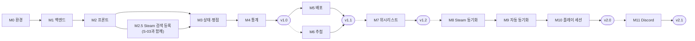

# PLAYLEDGER — 개발 계획

> **무엇을 어떤 순서로 만들고 어디까지 왔는지** 적는 문서다. 진행 상황은 **여기에만** 둔다.
> 겪은 일 · 막힌 일은 [DEVLOG](DEVLOG.md), 결정의 이유는 [decisions/](decisions/README.md), 기능 번호(F-xx)는 [REQUIREMENTS](REQUIREMENTS.md) 4장.

---

## 1. 목표와 전제

사놓고 안 한 게임을 숫자로 보여 주는 앱을 **v1.0(M4)까지 완성**한다. **v1.0이 완결된 앱이다.** 이후 버전은 그 위에 하나씩 얹는 확장이고, 어느 단계에서 멈춰도 그 시점까지는 완성품으로 남는다.

- 1인 프로젝트(자기계발 · 취미). 퇴근 후와 주말에 틈틈이 한다. 일정은 마일스톤 단위이고 날짜를 고정하지 않는다
- 출근(10/19) 전 v1.0 목표는 달성하지 못했고 9/30 ~ 10/23 공백도 있었다. 실패로 보지 않는다. 다만 v1.0 전에 멈추면 완성품 없이 끝날 가능성이 크고, 짧은 세션으로 이어 가므로 **세션 하나가 끝날 때마다 다음 세션이 바로 시작할 수 있는 상태**(`DEVLOG` "현재 상태")를 남기는 것이 일정보다 중요하다
- Vue와 비동기 SQLAlchemy를 처음 다뤘다. 두 개를 한 단계에서 같이 배우면 문제가 생겼을 때 어느 쪽 문제인지 판별하기 어려워, M1(백엔드)을 끝낸 뒤 M2(프론트)로 넘어갔다

---

## 2. 진행 현황

| 단계 | 내용 | 버전 | 상태 |
|---|---|:---:|---|
| M0 | 환경 구성 | v1.0 | ✅ 2026-09-19 |
| M1 | 백엔드 기초 (인증 + CRUD + 테스트) | v1.0 | ✅ 2026-09-28 |
| M2 | 프론트 연동 | v1.0 | ✅ 2026-11-03 |
| M2.5 | Steam 검색 등록 + 커버 이미지 | v1.0 | ✅ 2026-11-03 |
| M3 | 상태 관리 + 평점 | v1.0 | ✅ 2026-11-04 |
| M4 | 통계 대시보드 | **v1.0** | ✅ 2026-11-04 |
| M4.5 | 배포 전 정비 | **v1.0** | ✅ 2026-11-04 (`v1.0.0` 태그) |
| M5 | 배포 | v1.1 | ⬜ |
| M6 | 다음 게임 추첨 | v1.1 | ⬜ |
| M7 | 위시리스트 + 구매 전 경고 | v1.2 | ⬜ |
| M8 | Steam 동기화 | v2.0 | ⬜ |
| M9 | Steam 자동 동기화 | v2.0 | ⬜ |
| M10 | 플레이 세션 + 히트맵 | v2.0 | ⬜ |
| M11 | Discord 로그인 | v2.1 | ⬜ |

표기: ⬜ 시작 전 / 🔄 진행 중 / ✅ 완료 + 날짜.

| 버전 | 단계 | 포함 기능 (`REQUIREMENTS` 4장) |
|:---:|---|---|
| **v1.0** | M0 ~ M4.5 | F-01 ~ F-11, F-22, F-24, F-31 |
| v1.1 | M5, M6 | F-14 |
| v1.2 | M7 | F-13, F-18 |
| v2.0 | M8, M9, M10 | F-12, F-19, F-20 |
| v2.1 | M11 | F-21 |

> v0(RN + Django + MariaDB)의 진행 결과는 `v0-rn-django` 태그의 문서에 보존되어 있다. 이 문서의 M0 ~ M11은 새 스택 기준으로 다시 시작한 번호다.

---

## 3. 마일스톤 상세

### M0. 환경 구성 ✅

목표: 개발 환경을 갖추고, 화면 → 서버 → DB가 한 줄로 이어지는 것을 확인. 작업 목록과 각주는 [archive/MILESTONES_M0_M1](archive/MILESTONES_M0_M1.md).

**완료 기준**
- [x] `docker compose up` 후 HeidiSQL로 PostgreSQL에 접속됨
- [x] `http://localhost:8001/docs`에서 Swagger 화면이 열림
- [x] Vue 화면에 `/api/health` 응답이 표시됨 (프록시 경유 = 같은 출처 확인)
- [x] `git status`에 `.env`, `venv/`, `node_modules/`가 안 잡힘

---

### M1. 백엔드 기초 (인증 + CRUD + 테스트) ✅

목표: 프론트 없이 백엔드만으로 모든 데이터 조작이 가능하고, 핵심 규칙이 자동 테스트로 보호되는 상태. 작업 목록과 각주는 [archive/MILESTONES_M0_M1](archive/MILESTONES_M0_M1.md).

**완료 기준**
- [x] "A 계정의 기록이 B 계정에 안 보임" 테스트 통과
- [x] 다른 사용자의 기록을 ID로 직접 요청하면 404
- [x] 폐기된 refresh 토큰으로 재발급을 요청하면 401
- [x] GitHub Actions 초록불
- [x] Swagger에서 가입 → 로그인 → 게임 등록 흐름을 손으로 한 번 확인

---

### M2. 프론트 연동 ✅

| 항목 | 내용 |
|---|---|
| 목표 | 브라우저에서 로그인하고, 목록을 보고, 게임을 추가할 수 있음 |
| 기술 요소 | Vue Router, Pinia, fetch, Tailwind, shadcn-vue, Vitest, CSS 변수 테마 (다크 · 라이트) |

**작업 목록**

*1단계 · 껍데기*
- [x] Vite 템플릿 잔재 정리 (`index.html` 제목 · 파비콘, `public/`, `web/README.md`) *(계획에 없던 작업)*
- [x] 라우터 (가드 없이) + 빈 페이지 4종, `App.vue`를 `<router-view>`로 교체 (M0 헬스체크 임시 코드 제거)
- [x] 메인 레이아웃 (48rem 기준 사이드바 · 하단 탭)
- [x] API 호출 모듈 1차 (`api/` — 토큰 첨부, 401 재시도 없음)

*2단계 · 인증*
- [x] auth 스토어 (Pinia) — access 토큰은 스토어가 아니라 `api/client.ts`가 보관
- [x] S-01 로그인 · 가입
- [x] API 호출 모듈 2차 (401 재발급 후 재시도, 동시 재발급 1회 보장 — `ARCHITECTURE` 3.3절)
- [x] 설계 검증에서 찾은 경쟁 상황 2건 — 다른 요청이 이미 새 TOKEN을 받아온 뒤 도착한 401은 재발급 없이 재시도, 재발급 중 로그아웃하면 늦게 온 TOKEN을 버림 *(계획에 없던 작업)*
- [x] 앱 시작 시 로그인 복원 + 라우터 가드 (`DESIGN` 2.3절)
- [x] 설계 검증에서 찾은 구멍 2건 — 복원 중 `/me`만 실패하면 TOKEN도 비움, 쓰는 도중 세션이 끝나면 App.vue가 로그인 화면으로 보냄 (가드는 이동할 때만 돈다) *(계획에 없던 작업)*
- [x] 로그인 후 돌아갈 주소 검사 `safeRedirect` — `//evil.example` 같은 외부 주소 차단 *(계획에 없던 작업)*
- [x] S-06 설정 (계정 정보, 로그아웃)
- [x] 직접 로그아웃과 세션 만료 구분 (`sessionEnd`) — 로그아웃은 `/login`, 만료는 `/login?redirect=…` *(계획에 없던 작업)*
- [x] 메인 레이아웃을 목업에 맞춤 — 로고 점, 활성 메뉴 옅은 바탕 + 포인트 글자, lucide 아이콘(사이드바 · 하단 탭) *(계획에 없던 작업)*

*3단계 · 데이터*
- [x] S-02 라이브러리 목록 (20개씩 추가 로드)
- [x] 빈 상태 처리
- [x] 로딩 표시 (skeleton)
- [x] S-03 등록 폼 (장르 선택 포함) — Steam 자동완성은 M2.5
- [x] 오류 처리 (네트워크 실패, 401 만료) — 첫 로딩 실패는 목록 대신 안내 + 다시 시도, 추가 로딩 실패는 받은 목록을 두고 다시 시도. 401은 API 모듈 2차 · App.vue가 처리
- [x] S-02 요약 줄의 미시작 개수 — 목록 요청과 동시에 `status=BACKLOG&limit=1`로 개수만 받음. 실패해도 목록은 보인다 *(계획에 없던 작업)*
- [x] 카드 · 등록 버튼이 갈 자리 — `/library/new` · `/library/:id` 경로와 자리표시 화면 (S-03 · M3 S-04에서 채움) *(계획에 없던 작업)*

*설계 문서 정합 (계획에 없던 작업)*
- [x] `ARCHITECTURE` 6장 `web/src` 구조에 `lib/` · `components/ui/` 추가 (**shadcn 컴포넌트를 받기 전에**)

*스타일 기준 (계획에 없던 작업)*
- [x] 레퍼런스 수집 — Backloggd(Figma, 9/30). 결정만 `DESIGN`에 남김
- [x] 화면 목업 — 디자인 캔버스에 컬러 시안 4개 · 상태색 비교 · 화면 11개(S-07 제외). 원본 사본은 `docs/mockups/` (10/24)
- [x] 상태 5색 확정 — 현행안 유지 (`DESIGN` 4.1절, 10/24)
- [x] 브랜드 컬러 · 톤 결정 — A · 심야 극장 `#D12E34`, 다크 · 라이트 토큰 (`DESIGN` 4.4절, 10/24)
- [x] 테마 토큰 적용 — shadcn CSS 변수(`--primary` 등)를 `src/style.css`에서 `DESIGN` 4.4절 값으로 재정의, 다크는 `.dark` 한 벌 더
- [x] 테마 전환 (F-24, v1.0으로 앞당김) — 시스템 설정 연동 + S-06에서 `시스템 / 다크 / 라이트` 선택
- [x] S-01을 목업에 맞춰 다시 그림 (카드 제거, 추상 타일 배경, 가입 폼 도움말)
- [x] 화면 4종(S-01 · S-02 · S-03 · S-06)에서 반복되는 패턴을 공용 컴포넌트로 추출 — `FormField` · `SurfacePanel` · `StatusDot` · `EntrySummary`, 버튼 · 입력칸 모서리 기본값 10px
- [x] S-02 카드에 커버 이미지 슬롯을 비워두는 레이아웃 — 커버가 없을 때의 대체 표시 포함
- [x] ESLint · Prettier 도입 여부 판단 — 둘 다 도입 (`npm run lint` · `format:check`, CI 포함). 이유는 [DEVLOG_M2](archive/DEVLOG_M2.md) 2026-11-03 (7)
- [x] 상단 메뉴 시안 비교 · 채택 (`mockups/TopNavBoard`, [0010](decisions/0010-top-nav.md)) *(계획에 없던 작업)*
- [x] 메인 레이아웃을 상단 메뉴 띠로 교체 + 등록 버튼 이동 (`DESIGN` 2.2절) *(계획에 없던 작업)*

*정리 (계획에 없던 작업)*
- [x] 보유 기록 라우터의 404 · 장르 검사 중복 제거 (응답 변경 없음)
- [x] auth 스토어 — 로그인 중 `/me`가 실패하면 access 토큰도 되돌림 (복원 + 가드 작업 전에)
- [x] `CLAUDE.md` 추가, 브랜치 운영을 `main` 단일 브랜치로 전환 (`m2-frontend`는 PR #3으로 중간 병합)

*검증 수단 (계획에 없던 작업)*
- [x] GitHub Actions에 프론트 job 추가 (`npm ci` → `npm run lint` → `npm run format:check` → `vue-tsc -b --noEmit` → `npm test` → `npm run build`)
- [x] Vitest 도입, API 호출 모듈 1차 테스트 10건 (`detail` 자료형 분기 · 204 본문 미읽기 · 네트워크 실패 · 토큰 헤더)
- [x] API 호출 모듈의 401 처리 4원칙 테스트 (`ARCHITECTURE` 3.3절) — 2차 구현과 함께. 경쟁 상황 · 실패 포함 9건 (Vitest 합계 19건), 뮤테이션으로 장치 5개 검증

**완료 기준**
- [x] 새로고침 시 네트워크 탭에 `/api/auth/refresh`가 1건만 기록되고, 응답이 오기 전에 `/login`으로 이동하지 않음 — 2026-10-25 실측: `/library?status=BACKLOG` 새로고침 → `/api/auth/refresh` 1건 · `/api/auth/me` 1건, 주소 유지
- [x] 화면에서 등록한 게임이 DB에 실제로 저장됨 — 2026-11-03 실측: 화면에서 저장 → POST 201, psql로 조회해 구매일 · 구매가 66000 · 3744분 · 평점 4 · 한줄평 · 장르 3개 일치
- [x] 데이터가 0개인 상태에서도 화면이 정상으로 보임 — 2026-10-25 실측: 게임 0개 계정에서 점선 포스터 칸 + "아직 등록된 게임이 없어요" + `게임 추가하기`
- [x] 브라우저 개발자 도구의 모바일 폭에서 하단 탭으로 전환됨
- [x] 로그아웃 후 브라우저 뒤로가기로 `/library`에 들어가면 `/login`으로 밀려남 — 2026-10-25 실측: `/library` → `/settings`에서 로그아웃 → `/login`, 뒤로가기 → `/login?redirect=/library`
- [x] 같은 창에서 A로 로그아웃 → B로 로그인했을 때, A의 목록이 화면에 남아 있지 않음 — 2026-10-25 실측: A(25개)로 목록을 본 뒤 설정에서 로그아웃 → B(0개) 로그인 → 라이브러리 카드 0장 · 빈 상태. 목록 상태를 스토어가 아니라 화면이 만들어서 A의 목록이 남을 자리가 없다
- [x] `npm run build` 결과물(`dist/`)에서 토큰 · 비밀값 문자열이 검색되지 않고, localStorage에 테마 선택 외의 값이 없음 — 2026-10-25 실측: `dist/`에서 JWT 형태 · `JWT_SECRET` · `DATABASE_URL` · `POSTGRES_PASSWORD` · 쿠키 이름 검색 결과 없음, 로그인 후 localStorage는 `pl-theme` 하나
- [x] S-06 테마가 `시스템`일 때 OS(또는 개발자 도구의 `prefers-color-scheme` 에뮬레이션)를 다크 ↔ 라이트로 바꾸면 새로고침 없이 화면이 따라 바뀜 (F-24) — 실측: 다크 에뮬레이션 → 라이트로 바꾸자 같은 페이지에서 배경 `#F6F6F8`로 전환
- [x] S-06에서 `다크`를 고르고 새로고침해도 다크가 유지되고, 첫 화면이 라이트로 번쩍였다가 바뀌지 않음 — 실측: OS 라이트 + `다크` 선택 후 새로고침 → 첫 확인부터 `.dark` · `color-scheme: dark`. `index.html` 인라인 스크립트가 앱보다 먼저 입힌다
- [x] 화면 4종(S-01 · S-02 · S-03 · S-06)의 다크 · 라이트가 `docs/mockups/`의 같은 화면과 색 · 배치가 같음 — 2026-11-03 실측: 나란히 찍어 대조. 메뉴는 `TopNav` 시안 H 기준. 일부러 다르게 둔 것은 [DEVLOG_M2](archive/DEVLOG_M2.md) 2026-11-03 (4)

> **테마 선택은 localStorage에 둔다:** 완료 기준 7번은 원래 "localStorage가 비어 있음"이었다. 그 기준이 막으려던 것은
> 토큰 · 비밀값이다. 테마 선택(`시스템 / 다크 / 라이트`)은 비밀이 아니고 로그인 전 S-01에서도 필요해서 브라우저에 저장하므로,
> "테마 선택 외의 값이 없음"으로 고쳤다.

> **완료 기준 1번의 문구를 바꾼 이유:** 원래 문구는 "로그인 화면이 깜빡이지 않음"이었다.
> 깜빡임은 기기 속도에 따라 보이기도 안 보이기도 해서, 로직이 맞아 안 보이는 것인지
> 빨라서 안 보이는 것인지 구분되지 않는다. 판정 근거를 네트워크 탭의 관찰값으로 옮겼다.

> **프론트를 pytest처럼 판정할 수 없는 것에 대해:** 자동 검증은 두 층으로만 둔다.
> CI의 타입 검사 · 빌드는 컴파일 오류가 `main`에 들어가는 것을 막고, Vitest는
> 눈으로 판정하기 어려운 것만 맡는다 — 토큰 만료 · 동시 재발급처럼 손으로 만들 수 없는 상황,
> 그리고 결과가 같아 보여 결과만으로는 구분되지 않는 동작(204에서 본문을 읽지 않는지 등).
> 나머지 완료 기준은 수동으로 보되, "확인함"이 아니라 관찰값을 `DEVLOG`에 남긴다.

> **완료 기준 4번("모바일 폭에서 하단 탭으로 전환됨")의 전환 지점이 기기마다 다르다:**
> 데스크톱 A는 864px, 데스크톱 B는 632px에서 전환됐다. `48rem`이 루트 글꼴 크기에
> 곱해지는 값이라 브라우저 · OS 설정에 따라 달라지며, 이것이 rem을 쓴 의도이기도 하다
> (`DESIGN` 2.2절). 완료 기준은 "몇 px에서 바뀌는가"가 아니라 "바뀌는가"를 묻는다.

> **공용 컴포넌트 추출을 M2 끝에 두는 이유:** 화면이 하나뿐인 시점에 공용 컴포넌트를 설계하면
> 두 번째 화면에서 맞지 않아 다시 뜯게 된다. 반복되는 패턴은 발견하는 것이지 미리 정하는 것이 아니다.
>
> **색 · 목업은 앞당겼다 (10/24):** 원래 이 묶음 전체를 2 · 3단계 뒤에 두었으나, 목업 없이
> 화면을 만들면 기본값만 쓰여 판단 주체가 없다는 문제가 S-01에서 이미 드러났다. 색과 화면 목업을
> 먼저 정하고, 공용 컴포넌트 추출만 화면이 나온 뒤로 남긴다. M4의 S-05 Figma 목업 항목은
> 이번 목업에 통계 화면이 포함되어 차트 배치를 다듬는 일만 남는다.

---

### M2.5. Steam 검색 등록 + 커버 이미지

| 항목 | 내용 |
|---|---|
| 목표 | 등록 폼에서 영어 제목을 치면 Steam 후보가 뜨고, 고르면 `steam_appid` · 한국어 이름 · 커버 · 장르가 함께 들어옴 (사용자가 페이지를 떠나지 않음) |
| 기술 요소 | `IStoreService/GetAppList` 미러링, `appdetails`, httpx, PostgreSQL `pg_trgm` · GIN 인덱스, 자동완성 UI (debounce · 키보드 조작) |

결정: [위치 0007](decisions/0007-steam-search-in-v1.md) · [검색 방식 0008](decisions/0008-steam-app-mirror.md) · [수동 · Steam 분리 0009](decisions/0009-manual-steam-separate.md). 흐름은 `ARCHITECTURE` 5.3절.
커버 이미지 자체가 필요해서가 아니라 외부 API 수집 · 전문 검색 · 자동완성 UI를 익히는 것이 목적이라 앞당겼다.

**작업 목록**
- [x] Steam API 실측 — 옛 `GetAppList` 404, 키로 게임 198,137건, 한글 이름 310건 *(계획에 없던 작업)*
- [x] `steam_apps` · `pg_trgm` · `games.cover_url` 마이그레이션
- [x] 게임 목록 미러링 스크립트
- [x] 검색 API (`GET /api/steam/apps`)
- [x] 등록 API에 `steam_appid` 추가 — 한국어 이름 · 커버 · 장르 · 출시일
- [x] S-03 제목 자동완성 (`M2` S-03과 함께)
- [x] S-02 카드 · 포스터 벽에 커버 표시 — 주소가 깨지면 제목 앞 두 글자로 대체
- [x] 동시 등록 · 외부 API 실패 테스트

**완료 기준**
- [x] 스크립트를 두 번 돌려도 `steam_apps` 행 수가 늘지 않고, 출력과 로그에 키가 찍히지 않음 — 2026-11-03 실측: 두 번 다 198,120행, 약 20초
- [x] `hollow kn`으로 Hollow Knight가, 오타 `hollow knigt`로도 맨 위에 나옴 — 실측: `/api/steam/apps?q=hollow%20knigt` 200. `hollow`만 치면 48등이라 기준을 고쳤다 (인기도 정보가 없음, decisions/0008)
- [x] `Black Myth: Wukong`을 고르면 라이브러리에 `검은 신화: 오공`과 커버가 보임 — 실측: 커버 460×215 로드, 장르 액션 · RPG · 어드벤처
- [x] 없는 appid로 직접 요청하면 422이고 `games`에 행이 생기지 않음 (테스트)
- [x] `appdetails`가 실패해도 201이고, 다음 사람이 같은 게임을 등록하면 커버가 채워짐 (테스트)
- [x] 같은 appid 동시 등록에도 `games`가 한 행 (테스트)
- [x] 키가 없는 CI에서 서버 테스트가 통과함 — `b8925eb` CI `test` · `web` 성공

---

### M3. 상태 관리 + 평점 ✅

| 항목 | 내용 |
|---|---|
| 목표 | 게임의 생애주기(등록 → 플레이 → 클리어)를 화면에서 관리 |
| 기술 요소 | Vue 조건부 렌더링, Motion |

**작업 목록**
- [x] S-04 상세 화면 — 수정 버튼 · ⋮는 아래 수정 · 삭제 작업에서 붙인다
- [x] 상세 화면에서 상태 직접 변경
- [x] 시간당 비용을 응답에 추가 (`cost_per_hour`) — S-04가 "서버 계산값"을 보여 줘야 해서 M4 항목에서 건별 계산만 당겼다 *(계획에 없던 작업)*
- [x] 범위 밖 id(0 · 음수 · int 초과)를 500 대신 404로 *(계획에 없던 작업)*
- [x] Steam 검색 테스트의 `[Vue warn]` 정리 (effectScope) *(계획에 없던 작업)*
- [x] 평점 · 한줄평 입력 (`CLEARED` / `DROPPED`일 때만 노출) — 등록 폼(S-03)은 M2.5에 있었고, 상세 화면에서 바로 입력을 더했다
- [x] 평점 보존 규칙 (`DESIGN` 4.3절) — 서버(pytest `test_rating_survives_replay`) · 상세 화면(상태만 보냄) · 수정 본문 규칙(`buildUpdateBody`, 숨긴 평점은 안 보냄). 수정 화면은 아래 작업에서 이 규칙을 쓴다
- [x] 상태별 필터 + 주소 쿼리 반영 (정렬 · 장르 필터는 M4 대조에서 찾아 넣었다)
- [x] 카드 두 번째 줄 상태별 분기 (미시작은 방치일수) — M2의 `cardMetric`이 이미 표와 같아 코드는 고치지 않고 테스트만 보강
- [x] 수정 화면 (등록 폼 재사용) — 칸은 `EntryFormFields`로 나눠 등록과 같이 쓴다. S-04에 수정 버튼
- [x] 삭제 (확인 다이얼로그) — S-04 `⋮` 메뉴. 새 의존성 없이 reka-ui로 만들었다
- [x] 수정과 삭제가 겹치면 나던 500을 막음 (수정 API 행 잠금) *(계획에 없던 작업)*
- [x] 저장 성공 알림 (toast + Motion) — 등록 · 수정 · 삭제. 이유는 [DEVLOG_M3](archive/DEVLOG_M3.md) 2026-11-04 (4)

**완료 기준**
- [x] `DESIGN` 3.2절의 상태별 카드 표시가 5가지 상태 모두 동작 — 2026-11-04 실측: 5상태 + 방치 0 · 179 · 180 · 214일 + 구매일 없음을 다크 · 라이트 화면에서 읽어 표와 일치. 180일부터 굵게 · 포인트 색, 179일은 기본
- [x] 필터로 상태별 조회가 되고, 결과가 없으면 안내 문구 표시 — `미시작` 칩 → 1개, `보류` 칩 → "해당 상태의 게임이 없습니다" (2026-11-03 (5))
- [x] `PLAYING` → `CLEARED`로 바꾸면 평점 입력란이 나타남 — 상세 화면에서 바꾸자 별 5개 · `한줄평 남기기`가 나타남, 별 3개 · 한줄평 저장 후 응답 `rating: 3` (2026-11-03)
- [x] `CLEARED` → `PLAYING` → `CLEARED`로 바꿔도 이전 평점이 남아 있음 — pytest `test_rating_survives_replay`, 상세 화면에서 바꿨다 되돌려 별 4개 · 한줄평 다시 보임 (2026-11-03)
- [x] 필터가 걸린 주소에서 새로고침해도 필터가 유지됨 — `/library?status=CLEARED`로 바로 들어가 `클리어` 칩이 눌린 채 2개만 보임 (2026-11-03)

---

### M4. 통계 대시보드 → **v1.0 릴리즈** ✅

| 항목 | 내용 |
|---|---|
| 목표 | 이 프로젝트가 풀려는 문제("얼마나 안 하고 있는가")를 숫자로 보여줌 |
| 기술 요소 | SQL 집계(GROUP BY, JOIN, FILTER), 날짜 연산, ECharts |

**작업 목록**
- [x] S-05 레퍼런스 수집 + Figma 목업 (shadcn 커뮤니티 키트 기반, 결정은 `DESIGN`에 반영) *(계획에 없던 작업)* → 2026-10-24 전체 화면 목업(`docs/mockups/` `Stats` · `StatsMobile`)에 포함해 완료. Figma 대신 디자인 캔버스로 그림
- [x] 장르별 완주율 차트를 ECharts로 옮기며 배치 다듬기 — 목업은 CSS 막대로 그렸다 *(계획에 없던 작업)*
- [x] `npm audit` 19건 → 15건 — `vite` · `vitest` · `source-map-js` 올림. 남은 건 이유는 DEVLOG 2026-11-04 (5) *(계획에 없던 작업)*
- [x] 테스트용 게임 데이터 20개 이상 입력 — 26개 (시드 스크립트 — `find_or_create_game` 경유, `ARCHITECTURE` 2.2절)
- [x] 집계 쿼리를 HeidiSQL에서 먼저 검증 (`DATA_MODEL` 3장) — HeidiSQL 대신 `psql`로 같은 SQL을 돌렸다
- [x] 총계 (총 보유 / 미시작 수)
- [x] 사장률
- [x] 완주율 (분모에서 미시작 제외)
- [x] 방치 게임 추출
- [x] 시간당 비용 (플레이타임 0 처리 포함) — 건별 값(`cost_per_hour`)은 M3에서 응답에 넣었다. 남은 것은 통계의 "시간당 비용이 높은 게임" 집계
- [x] 장르별 완주율
- [x] 계산 함수 pytest
- [x] S-05 통계 화면 (ECharts)
- [x] 상태 · 장르 필터와 정렬 완성 (F-03) — 정렬 · 장르 필터가 M2 ~ M4 어느 작업 목록에도 없어 v1.0 대조에서 찾았다 *(계획에 없던 작업)*
- [x] 비기능: 게임 200개 목록 1초 이내 측정 — 2026-11-04 실측: 정렬 · 필터 조합 최대 21ms, 통계 18ms *(계획에 없던 작업)*
- [x] 구매일 달력 · 상태 선택 · ⋮ 메뉴 · 삭제 대화상자를 shadcn 부품으로 *(계획에 없던 작업)*
- [x] `v1.0.0` 태그 (2026-11-04, M4.5를 닫은 뒤 사용자 지시로)

**완료 기준**
- [x] 게임 20개 이상 등록 상태에서 통계 화면의 모든 수치가 손으로 계산한 값과 일치 — 2026-11-04 실측: 예시 26개. 26 / 8 / 42.3% / 33.3%, 목록 2개, 장르 8줄 모두 일치 ([DEVLOG_M4](archive/DEVLOG_M4.md) 2026-11-04 (6))
- [x] 계산 함수 테스트 통과 — `pytest` 90 passed, 서비스를 6가지로 망가뜨려 모두 실패 확인
- [x] 플레이타임이 0인 게임의 시간당 비용이 `—`로 표시됨 — S-04에서 `—`. 통계 순위는 값이 없어 줄에서 뺀다
- [x] 게임이 0개인 계정에서 통계 화면이 오류 없이 안내 문구 표시 — 2026-11-04 실측: "게임을 등록하면 통계가 표시됩니다", 콘솔 오류 없음

> **여기까지가 완결된 앱이다.** 이후 버전은 모두 이 위에 얹는 확장이다.

---

### M4.5. 배포 전 정비 *(계획에 없던 단계)*

| 항목 | 내용 |
|---|---|
| 목표 | 공개 서버에 올려도 되는 상태로 만든다. 배포 뒤에는 확장 · 개선만 남게 한다 |
| 근거 | 2026-11-04 저장소 전체 점검. 재현 · 대조 표는 [DEVLOG_M4.5](archive/DEVLOG_M4.5.md) |

**작업 목록**

*A. 서버 구멍*
- [x] 동시 중복 등록 500 → 409 (제약 이름 불일치)
- [x] JWT 비밀 32자 미만이면 시작 거부, 설정의 모르는 키 무시, `.env` 경로 고정
- [x] 로그인 · 가입 · 등록 요청 제한 (429), 해시를 별도 스레드로
- [x] 깨진 문자(NUL · 서로게이트) · 큰 offset · 터무니없는 구매일 · 공백 비밀번호 거절
- [x] 422 응답에서 입력값 제거, 예상 못 한 오류를 한국어 JSON으로
- [x] Steam 호출 중 DB 연결 반납, HTTP 클라이언트 공유, `pool_pre_ping`, 로그에 SQL 값 숨김
- [x] DB까지 보는 헬스체크, 운영에서 `/docs` 끄는 설정, 만료 토큰 정리
- [x] `/refresh` · `/logout` 출처 검사

*데이터 · 계정*
- [x] 직접 등록 게임을 사용자별로 분리, Steam 게임만 공유 ([decisions/0011](decisions/0011-manual-games-per-user.md))
- [x] 계정 삭제 (API · S-06), 개인정보 안내, 수집 항목 문구 정정

*B. 화면 · 세션*
- [x] 탭 여러 개 동시 재발급으로 로그아웃되는 문제
- [x] 화면 모듈 · 렌더 오류 안내, 요청 타임아웃, 복원 중 일시 장애 구분, 로그아웃 실패 처리
- [x] 스크롤 복귀, 필터 유지 복귀, 수정 중 이탈 확인
- [x] 포커스 표시, 탭 제목, 화면 전환 안내
- [x] iOS 입력 확대, 터치 44px, 안전 영역, 404 화면, 공유 메타, 내부 용어 제거
- [x] 안 쓰는 부품 · 토큰 삭제

*C. 구조 · 테스트*
- [x] 인증 판단을 `services/auth.py`로 분리
- [x] 빠진 서버 테스트 (인증 실패 경로 · 쿠키 속성 · 수정 경계 · Steam 실패 · 스크립트)
- [x] 이번에 더한 화면 분기(오류 처리 · 이탈 확인 · 재발급 잠금)를 테스트. 기존 화면을 쪼개는 리팩터링은 하지 않았다

*D. 공개 준비 · 문서*
- [x] `LICENSE`, `requirements-dev.txt` 분리 (운영 `.env` 예시는 구성이 정해지는 M5로)
- [x] CI: Ubuntu 고정 · `alembic check` · 취약점 검사
- [x] README 실행 순서 · 진행 상태, ARCHITECTURE · DATA_MODEL · CLAUDE 함정 어긋남
- [x] 프록시 결정 ([decisions/0012](decisions/0012-caddy-proxy.md))과 M5 작업 목록 다시 쓰기

**완료 기준**
- [x] `pytest` 310건 · `npm test` 202건 · CI 통과, 고치기 전 실패를 확인한 재현 테스트가 통과
- [x] 서로 다른 두 탭을 동시에 열어도 로그아웃되지 않음 (헤드리스 Edge 10번. 잠금을 끄면 3번째에 로그아웃)
- [x] A가 직접 등록한 제목 · 장르가 B에게 보이지 않음
- [x] 계정을 삭제하면 그 사람의 기록 · 토큰 · 직접 등록 게임이 사라지고 Steam 게임과 남의 기록은 남음
- [x] v1.0 대조 표 재작성 (`CLAUDE.md` "끝날 때")

---

### M5. 배포 (v1.1)

| 항목 | 내용 |
|---|---|
| 목표 | 폰 브라우저로 어디서든 접속해 실제로 쓸 수 있는 상태. 데이터를 잃어도 되돌릴 수 있는 상태 |
| 기술 요소 | Docker Compose(운영 구성), Caddy([decisions/0012](decisions/0012-caddy-proxy.md)), HTTPS |
| 참고 | `cbt-journal` 저장소 `deploy/` · `docs/SERVER.md`. 계정 · 도메인은 전역 설정 "공용 인프라"를 먼저 본다 |

**작업 목록**
- [x] Tailwind 클래스 표준 표기로 정리 (VS Code 경고 88건 → 0건, 16px 화면 변화 없음) *(계획에 없던 작업)*
- [x] LICENSE 추가, `README` 개발 실행 방법 정리, `requirements-dev.txt` 분리 (M4.5)
- [ ] 서버 결정 — 11월은 Vultr 크레딧, 12월부터 AWS (전역 "서버 이사 계획"). 하위 주소 `play.sagming.com`, DNS만(회색 구름)
- [x] API Dockerfile (`requirements.txt`만, 비 root, `uvicorn --workers 1`). 요청 제한이 프로세스 메모리에 있어 워커를 늘리면 제한이 그만큼 늘어난다
- [x] 화면 빌드를 Caddy가 내주는 구성, 운영 Compose
- [x] Caddyfile: `/api` 프록시, SPA fallback(`try_files {path} /index.html`, 없으면 `/library` 새로고침이 404), 압축, 해시 파일 장기 캐시 · `index.html` 캐시 금지, 보안 헤더(HSTS · CSP · nosniff · Referrer-Policy)
- [ ] uvicorn `--proxy-headers --forwarded-allow-ips`를 Caddy로 한정 — 안 하면 모든 사용자가 한 IP로 묶여 요청 제한이 서로를 막고, 넓게 열면 헤더로 IP를 속일 수 있다. 다른 IP 둘로 실제 확인
- [x] 운영 `.env` 예시 (`ENABLE_DOCS=false`, 새 JWT 비밀, DB 비밀번호). 비밀값 · 서버 IP는 문서에 적지 않는다
- [x] 배포 순서 스크립트: 백업 → `alembic upgrade head` → 교체 → `/api/health` 확인. 실패 시 되돌리는 방법
- [ ] Steam 미러 첫 실행 (`sync_steam_apps`), M9 전까지 다시 돌리는 주기 정하기
- [ ] DB 매일 백업 + 서버 밖 보관 + **복구 리허설**(빈 DB에 되살려 기록 수 대조)
- [ ] 헬스체크 감시, 로그 회전, 디스크 여유 확인
- [ ] 200개 목록 응답 시간을 운영 서버에서 다시 측정 (`REQUIREMENTS` 6장, 로컬 21ms)
- [x] Inter · Noto Sans KR 내장 (`@fontsource-variable`). 외부로 나가는 글꼴 요청 없음, 전 화면 48장 비교에서 레이아웃 변화 없음
- [ ] 배포 후 `개인정보 안내` 다시 대조 (백업 보관 기간, 호스팅 업체)
- [ ] `SERVER.md` 작성, 클린룸 검증 (다른 PC에서 새로 클론)

**완료 기준**
- [ ] 폰 데이터(LTE)로 접속해 가입 · 로그인 · 게임 등록 · 계정 삭제가 됨
- [ ] `/library`에서 새로고침해도 화면이 나옴, `/docs`에 API 문서가 없음(Caddy가 /api만 넘겨 앱의 없는 주소 화면이 나온다), `/api/docs`는 404
- [ ] 다른 IP 둘에서 요청 제한이 따로 세어짐
- [ ] 백업으로 빈 DB를 되살려 기록 수가 같음
- [ ] 다른 PC에서 클론해 `README`만 보고 실행됨, 클린룸 검증에서 발견된 문제가 모두 수정됨

> PulseGrid의 클린룸 검증에서 4건의 문제가 발견됐다. 같은 방식으로 검증한다.

---

### M6. 다음 게임 추첨 (v1.1)

| 항목 | 내용 |
|---|---|
| 목표 | 미시작 게임 중 하나를 골라 "오늘 할 게임"을 정해줌 (F-14) |
| 기술 요소 | Motion, 접근성(동작 줄이기) |

**작업 목록**
- [ ] 무작위 선택 API (서버가 결과 결정)
- [ ] S-07 추첨 다이얼로그
- [ ] 룰렛 연출 (Motion)
- [ ] 동작 줄이기 설정 대응
- [ ] `이걸로!` → 상태 `PLAYING` 변경 후 S-04 이동
- [ ] `v1.1.0` 태그

**완료 기준**
- [ ] 결과가 항상 `BACKLOG` 상태의 게임
- [ ] 미시작 게임이 0개면 버튼이 비활성화되고 안내가 보임
- [ ] OS 동작 줄이기를 켜면 회전 없이 결과만 표시됨

---

### M7. 위시리스트 + 구매 전 경고 (v1.2)

| 항목 | 내용 |
|---|---|
| 목표 | 다음 충동구매 전에 내 패턴을 숫자로 확인 (F-13, F-18) |
| 기술 요소 | 트랜잭션, 다중 JOIN 집계 |

**작업 목록**
- [ ] `wishlist_items` 모델 + 마이그레이션
- [ ] 위시리스트 CRUD API
- [ ] 구매 전 경고 쿼리 HeidiSQL 검증 (`DATA_MODEL` 3.4절)
- [ ] 구매 전 경고 API
- [ ] 구매 전환 API (트랜잭션)
- [ ] S-08 위시리스트 화면 + 경고 배지
- [ ] 구매 전환 다이얼로그
- [ ] 트랜잭션 테스트
- [ ] `v1.2.0` 태그

**완료 기준**
- [ ] 구매 전환 도중 오류를 강제로 일으키면 양쪽 테이블이 모두 원래 상태로 남음 (테스트)
- [ ] 경고 수치가 손으로 계산한 값과 일치
- [ ] 경고가 떠도 구매가 가능함
- [ ] 위시리스트 게임이 통계 수치에 섞이지 않음

---

### M8. Steam 동기화 (v2.0)

| 항목 | 내용 |
|---|---|
| 목표 | 라이브러리를 손으로 다 입력하지 않아도 되게 함 (F-12) |
| 기술 요소 | httpx(비동기 외부 API 호출), 데이터 병합, API 키 관리 |

**작업 목록**
- [ ] Steam Web API 키 발급, `.env` 분리
- [ ] `steam_id` 저장 + 프로필 공개 안내
- [ ] 보유 게임 목록 조회
- [ ] 병합 규칙 구현 (`ARCHITECTURE` 5.1절)
- [ ] Steam 장르 자동 연결 (`steam_genre_id` 기준, DATA_MODEL 2.5절) — 규칙은 M2.5에서 만들었고 여기서는 동기화 경로에 연결만 한다
- [ ] 동기화에서도 수동 게임과 Steam 게임을 별개 행으로 둔다 ([decisions/0009](decisions/0009-manual-steam-separate.md))
- [ ] 동기화 결과 요약 (추가 N / 갱신 M / 변경 없음 K)
- [ ] S-06 Steam 연동 영역
- [ ] 비공개 프로필 오류 처리
- [ ] 병합 규칙 테스트

**완료 기준**
- [ ] 동기화 후 Steam 게임이 목록에 추가됨
- [ ] **직접 입력한 게임의 구매가 · 평점 · 한줄평이 그대로 남아 있음**
- [ ] 동기화를 두 번 연속 실행해도 중복 등록이 발생하지 않음
- [ ] 비공개 프로필로 동기화하면 원인이 담긴 메시지가 표시됨

> 완료 기준의 두 번째 조건이 이 단계의 본질이다. 데이터를 가져오는 것보다
> **기존 데이터를 지키는 것**이 어렵다.

---

### M9. Steam 자동 동기화 (v2.0)

| 항목 | 내용 |
|---|---|
| 목표 | 동기화 버튼을 누르지 않아도 매일 최신 상태 유지 (F-19) |
| 기술 요소 | Redis, 작업 큐, 워커, 스케줄러 |

**작업 목록**
- [ ] 작업 큐 도구 결정
- [ ] Redis 컨테이너 추가
- [ ] 워커 프로세스 구성
- [ ] 하루 1회 스케줄 등록
- [ ] Steam API 응답 캐싱

**완료 기준**
- [ ] 사용자 조작 없이 하루 1회 동기화 결과가 DB에 반영됨
- [ ] 같은 날 수동 · 자동 동기화가 모두 실행돼도 중복이 생기지 않음
- [ ] 워커가 동기화하는 동안에도 화면 응답이 느려지지 않음

---

### M10. 플레이 세션 + 히트맵 (v2.0)

| 항목 | 내용 |
|---|---|
| 목표 | "언제, 얼마나 하는지" 패턴을 날짜 단위로 기록하고 시각화 (F-20) |
| 기술 요소 | upsert, ECharts 캘린더 히트맵 |

**작업 목록**
- [ ] `play_sessions` 모델 + 마이그레이션
- [ ] 동기화 증가분 → 세션 생성 (기준점 규칙, `ARCHITECTURE` 5.1절)
- [ ] 수동 세션 추가 API
- [ ] 같은 날 합산 (upsert, `DATA_MODEL` 3.6절)
- [ ] S-04 플레이 기록 영역
- [ ] S-05 활동 히트맵
- [ ] 세션 규칙 테스트
- [ ] `v2.0.0` 태그

**완료 기준**
- [ ] 첫 동기화에서는 세션이 생기지 않음 (기준점)
- [ ] 두 번째 동기화부터 증가분이 그날의 세션으로 기록됨
- [ ] 같은 날 두 번 기록하면 한 행으로 합산됨
- [ ] 수동 게임에 세션을 추가하면 기존 플레이타임에 더해짐 (`REQUIREMENTS` 5.5절)

---

### M11. Discord 로그인 (v2.1)

| 항목 | 내용 |
|---|---|
| 목표 | Discord 계정으로 가입 · 로그인 (F-21) |
| 기술 요소 | OAuth 2.0, state 검증 |

**작업 목록**
- [ ] 계정 연결 정책 결정 — 같은 이메일 자동 연결 vs 로그인 상태에서 수동 연결 (`REQUIREMENTS` R-07)
- [ ] Discord 개발자 포털에 앱 등록
- [ ] `oauth_accounts` 모델 + 마이그레이션
- [ ] OAuth 흐름 구현 (`ARCHITECTURE` 4.3절)
- [ ] S-01 `Discord로 계속하기` 버튼
- [ ] S-06 Discord 연결 영역
- [ ] `v2.1.0` 태그

**완료 기준**
- [ ] state 값이 다른 콜백 요청은 거부됨
- [ ] 결정한 연결 정책대로 이메일 계정과 Discord 계정이 연결 또는 분리됨
- [ ] 빌드된 프론트 파일에서 client secret이 검색되지 않음

---

## 4. 진행 순서 및 의존 관계

> 실선은 반드시 앞 단계가 끝나야 시작할 수 있는 관계, 점선은 권장 순서다.

- M0 ~ M4는 **순차 진행 필수**
- M2.5는 M2의 S-03과 함께 진행한다 ([decisions/0007](decisions/0007-steam-search-in-v1.md))
- M8 → M9 → M10은 기술적으로 이어져 있다 (자동 동기화가 세션을 만든다)
- 점선 구간은 순서를 바꿔도 되지만, 버전 번호가 뒤섞이지 않도록 가급적 순서대로 진행한다

---

## 5. 일정 리스크

| 리스크 | 영향 | 대응 |
|---|---|---|
| 출근(10/19) 후 가용 시간 급감 | v1.0 전에 멈춤 | **실제로 발생** — 9/30 ~ 10/23 약 한 달 공백. 재개할 때 효과가 있었던 것을 대응으로 둔다: ①세션 끝에 `DEVLOG` "현재 상태"를 반드시 고친다 (재개 지점) ②`CLAUDE.md`로 작업 규칙을 저장소에 둔다 (세션 · 기기가 바뀌어도 같은 규칙) ③`main` 단일 브랜치 (어느 기기에서 어느 브랜치를 받아야 하는지 찾을 필요가 없음) ④세션 목표를 작업 항목 하나 단위로 작게 잡는다 |
| 기록하지 못하고 끝난 세션 | 공백 뒤 재개 지점을 잃음 | 9/29 저녁 ~ 9/30 세션이 기록 없이 끝나 대화 기록을 찾아 복원했다. 기록할 시간이 없으면 "다음에 할 일" 한 줄이라도 남긴다 |
| 몰입 구간 과부하 | 번아웃, 흥미 상실 | 세션 단위 목표를 작게 잡고, 세션 종료 절차(`DEVLOG` 기록)를 유지한다 |
| 마감 없는 범위 확대 | 완성 시점 소실 | 새 아이디어는 구현하지 않고 `REQUIREMENTS` 4.4절에 추가만 한다 |

기술적 리스크(학습 곡선, 외부 API 제약 등)는 `REQUIREMENTS` 7장에서 관리한다.

---

## 6. 완료 정의 (Definition of Done)

각 마일스톤은 아래를 **모두** 충족해야 완료로 본다.

1. 해당 단계의 완료 기준 체크박스가 전부 채워짐
2. 코드가 `main`에 push되어 있음 (2026-10-24부터 `main` 단일 브랜치. M0 · M1은 PR #1 · #2로 병합)
3. `DEVLOG`에 해당 세션 기록이 남아 있음
4. 임시 코드 / 주석 처리한 실험 코드가 제거됨
5. 테스트가 있는 단계는 GitHub Actions가 통과함
6. 버전의 마지막 마일스톤이면 버전 태그가 찍혀 있음

---

## 7. 문서 갱신 규칙

- 작업 항목을 완료하면 **그때 바로** 체크한다. 나중에 몰아서 하면 기억이 왜곡된다
- 계획에 없던 작업을 했으면 `*(계획에 없던 작업)*`을 붙여 체크박스를 **추가하고** 체크한다. 지우지 않는다
- 2장 표의 ✅는 완료 기준을 전부 충족한 시점에만 쓴다
- 범위를 바꾼 이유는 `decisions/`나 DEVLOG `[설계]`에 남긴다

> 계획대로 안 된 흔적을 지우지 않는 것이 이 문서의 목적이다.
> 결과만 남은 문서는 결과만 알려주지만, 과정이 남은 문서는 판단 근거를 알려준다.
