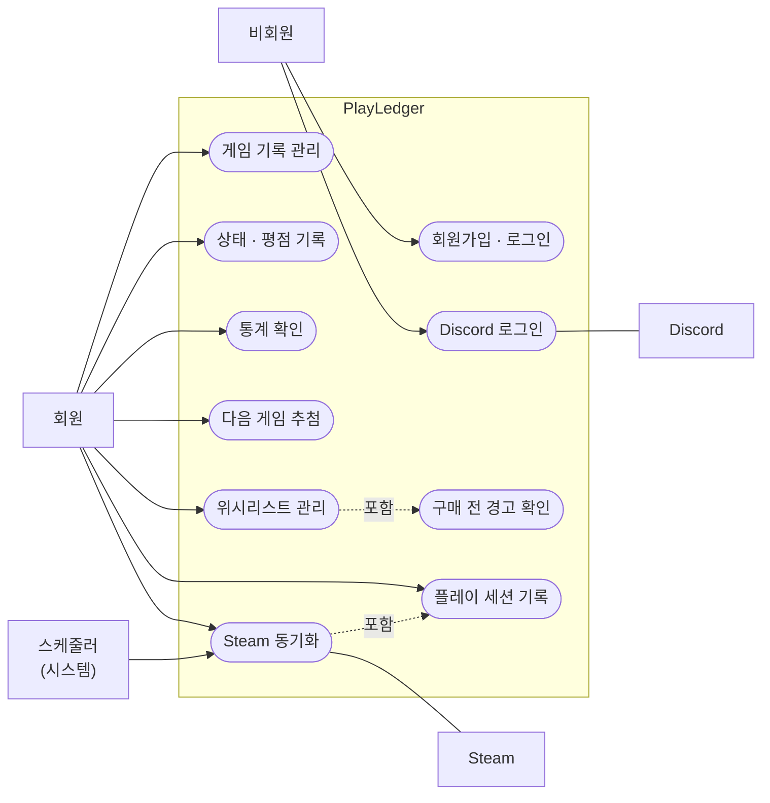

# PLAYLEDGER — 요구사항

> **무엇을 만들고 무엇을 만들지 않는지**, 기능 번호와 계산식을 적는 문서다.
> 단계와 진행 상황은 [PLAN](PLAN.md), 데이터 구조는 [DATA_MODEL](DATA_MODEL.md), 결정의 이유는 [decisions/](decisions/README.md).

---

## 1. 개요

### 1.1 왜 만드는가

스팀 세일 때마다 게임을 사지만, 실제로 플레이하는 비율은 그보다 훨씬 낮다.
문제는 "많이 샀다"가 아니라 **내가 얼마나 안 하고 있는지를 모른다**는 것이다.

- "이 게임 산 게 언제였지?"
- "작년에 산 것 중에 아직 시작도 안 한 게 몇 개야?"
- "정가 6만원 주고 산 게임, 결국 2시간 하고 접었으면 시간당 3만원인데?"
라이브러리 목록을 보는 것만으로는 이 질문에 답할 수 없다.

**보유 목록이 아니라 소비 이력을 기록하고, 그걸 숫자로 환산하는 것**이 이 프로젝트의 목적이다.

### 1.2 학습 목표

결과물과 별개로, 이 프로젝트로 익히려는 것:

| 영역 | 목표 |
|---|---|
| 백엔드 | FastAPI 비동기 구조, Pydantic 스키마 설계, SQLAlchemy(async) ORM, Alembic 마이그레이션 |
| 인증 | JWT access / refresh 토큰, httpOnly 쿠키, OAuth 2.0(Discord), 사용자별 데이터 격리 |
| 프론트엔드 | Vue 3 컴포넌트·라우팅, Pinia 전역 상태, Tailwind + shadcn-vue UI, ECharts 시각화, Motion 인터랙션 |
| 외부 API | Steam Web API 연동, 외부 데이터와 로컬 데이터 병합 |
| 비동기 작업 | Redis 기반 작업 큐로 주기적 동기화 |
| DB 설계 | 다대다 관계, 정규화, 사용자-데이터 관계 모델링 (PostgreSQL) |
| 테스트·운영 | pytest 자동 테스트, GitHub Actions CI, Docker Compose, Caddy 배포 |

### 1.3 기존 프로젝트와의 관계

| 프로젝트 | 성격 | 이번에 새로 하는 것 |
|---|---|---|
| PulseGrid | 실시간 모니터링 / FastAPI / 웹 | — |
| PartScope | 배치 분석 / SQLite / 콘솔 | — |
| **PlayLedger** | **기록·분석 / FastAPI + Vue / 웹** | **DB·인증을 포함한 전체 백엔드, 프론트엔드 프레임워크, 작업 큐, 배포** |

FastAPI는 PulseGrid에서 다뤘지만, 이번에는 DB 접근·인증·테스트까지 포함한 완결된 백엔드로 확장한다.

---

## 2. 용어 정의

| 용어 | 정의 |
|---|---|
| 게임(Game) | 게임 자체의 정보. 제목, 장르 등. Steam 게임은 모든 사용자가 공유하고, 직접 등록한 게임은 등록한 사람만 쓴다 |
| 보유 기록(Entry) | 특정 사용자가 특정 게임을 소유한 기록. 구매일, 구매가, 상태, 평점 등 |
| 백로그(Backlog) | 구매했으나 아직 시작하지 않은 게임 |
| 방치일수 | 구매일로부터 오늘까지의 일수 (상태가 '미시작'인 경우에만 의미 있음) |
| 시간당 비용 | 구매가 ÷ 총 플레이타임. 낮을수록 본전을 뽑은 것 |
| 사장률 | 전체 보유 게임 중 플레이타임 1시간 미만인 게임의 비율 |
| 위시리스트(Wishlist) | 아직 구매하지 않은 관심 게임. 보유 기록과 별도로 저장한다 |
| 플레이 세션(Session) | 특정 날짜에 특정 게임을 플레이한 기록. 직접 입력하거나 Steam 동기화로 자동 생성된다 |

---

## 3. 범위

### 3.1 하는 것

- 게임 보유 기록의 등록 / 조회 / 수정 / 삭제
- 진행 상태 관리 및 상태별 필터링
- 평점 및 한줄평 기록
- 보유 현황 통계 및 백로그 분석
- 회원가입 및 로그인 (사용자별 데이터 분리)
- 다크 · 라이트 테마 (시스템 설정 연동 + 수동 전환)
- 배포 및 실사용 (v1.1)
- Steam 라이브러리 동기화 · 자동 동기화 (v1.2)
- 비밀번호 변경 · 찾기, 이메일 인증 (v1.2)
- Discord 로그인 (v1.3)
- 확장 ─ "다음에 뭐 할까" 추첨 · 위시리스트 및 구매 전 경고 · 플레이 세션 기록 (순서 없음, 끝나는 순서대로 v1.4부터)

### 3.2 하지 않는 것 (Out of scope)

| 항목 | 이유 |
|---|---|
| 게임 추천 알고리즘 | 범위가 급격히 커지고, 이 프로젝트의 문제의식과 무관 |
| 소셜 기능 (친구, 공유, 댓글) | 핵심 문제 해결에 불필요 |
| 게임 구매 / 가격 비교 | PartScope와 성격이 겹침 |
| 네이티브 모바일 앱 | 반응형 웹으로 모바일 브라우저에 대응. v0에서는 반대로 웹을 제외했음 ([decisions/0002](decisions/0002-stack-switch.md)) |
| 타 플랫폼 연동 (Epic, GOG, PlayStation) | 사용자 라이브러리를 조회하는 공개 API가 없음 |

---

## 4. 기능 요구사항

우선순위는 **M**(MVP, v1.0) / **S**(직후, v1.2 ~ v1.3) / **L**(나중, 확장 기능 또는 버전 미정)이다. 어느 단계에서 만드는지는 `PLAN` 2장.

### 4.0 기능 개요 (유즈케이스)



> mermaid는 UML 유즈케이스 다이어그램을 공식 지원하지 않아 flowchart로 표현했다.
> 네모는 행위자, 타원은 유즈케이스, 점선 "포함"은 앞의 기능을 쓰면 뒤의 기능이 함께 일어남을 뜻한다.

### 4.1 필수 (MVP)

| # | 기능 | 설명 | 우선순위 |
|---|------|------|:---:|
| F-01 | 회원가입 / 로그인 | 이메일 + 비밀번호. JWT access 토큰 + refresh 토큰(httpOnly 쿠키). 사용자별로 데이터가 완전히 분리된다 | M |
| F-02 | 게임 등록 | 제목, 장르, 구매일, 구매가를 수동 입력 | M |
| F-03 | 목록 조회 | 보유 게임 목록. 상태별 / 장르별 필터, 정렬 | M |
| F-04 | 상태 관리 | 미시작 / 플레이중 / 클리어 / 보류 / 포기 5단계 전환 | M |
| F-05 | 수정 / 삭제 | 등록한 기록의 수정 및 삭제 | M |
| F-06 | 평점 / 한줄평 | 클리어 또는 포기 시 5점 척도 평점과 한줄평 기록 | M |
| F-07 | 플레이타임 기록 | 총 플레이 시간을 시간 단위로 입력. 세션 기록(F-20) 도입 후 계산 규칙은 5.5절 | M |
| F-24 | 다크 · 라이트 테마 | 기본은 시스템 설정을 따르고, 설정 화면에서 수동 전환. 색 토큰은 `DESIGN` 4.4절 | M |

### 4.2 핵심 차별 기능

| # | 기능 | 설명 | 우선순위 |
|---|------|------|:---:|
| F-08 | 백로그 대시보드 | 총 보유 수, 미시작 수, 완주율, 사장률을 한 화면에 표시 | M |
| F-09 | 방치 게임 추출 | 미시작 게임을 구매일이 오래된 순으로 자동으로 골라냄 (기준 일수 없이 최대 20개) | M |
| F-10 | 시간당 비용 계산 | 게임별 `구매가 ÷ 플레이타임` 산출 및 정렬 | M |
| F-11 | 장르별 통계 | 장르별 보유 수 / 완주율 / 평균 플레이타임 시각화 | M |
| F-22 | 게임 커버 아트 | Steam에서 고른 게임은 커버를 보여 준다. 없거나 깨지면 제목 앞 두 글자로 대체 | M |
| F-31 | 게임 목록 검색 등록 | 제목을 영어로 쳐서 Steam 게임 목록에서 고르면 한국어 이름 · 커버 · 장르 · 출시일이 함께 들어온다. Steam에 없는 게임을 위해 직접 입력은 병행한다 (R-03) | M |

### 4.3 확장 기능 (v1.2 이후)

| # | 기능 | 설명 | 목표 버전 | 우선순위 |
|---|------|------|:---:|:---:|
| F-14 | "다음에 뭐 할까" 추첨 | 미시작 게임 중 무작위 1개를 룰렛 애니메이션으로 제안 | 확장 (M9) | L |
| F-13 | 위시리스트 | 구매 전 관심 게임을 관리. 구매하면 보유 기록으로 전환 | 확장 (M10) | L |
| F-18 | 구매 전 경고 | 위시리스트 등록·구매 전환 시 해당 장르의 완주율과 미시작 수를 근거로 경고 표시 | 확장 (M10) | L |
| F-12 | Steam 연동 | Steam Web API로 라이브러리와 플레이타임 수집 (수동 실행, Steam OpenID로 계정 연결) | v1.2 (M6) | S |
| F-19 | Steam 자동 동기화 | 정해진 주기로 백그라운드에서 동기화 (Redis 작업 큐) | v1.2 (M7) | S |
| F-37 | Steam 게임 구매 정보 채우기 | 첫 동기화 뒤 새로 생긴 게임은 처음 본 날을 구매일로(동기화로 추정 표시), 빈 구매일 · 구매가만 모은 채우기 화면(S-10), 통계에 "N / M개 기준" 범위 표시. 정가 같은 추정값으로 채우지 않는다 ([decisions/0019](decisions/0019-steam-purchase-info.md)) | v1.2 (M6) | S |
| F-38 | Steam 구매 기록 가져오기 | 사용자가 Steam 구매 기록 · 라이선스 목록 페이지를 붙여넣으면 날짜 · 낸 금액을 읽어 내 Steam 게임과 맞춘다. 확인 후 저장, 원문은 저장하지 않음 (0019) | v1.2 (M6.5) | S |
| F-39 | 비밀번호 변경 | 로그인한 상태에서 현재 비밀번호를 확인하고 새 비밀번호로 바꾼다. 바꾸면 다른 기기의 로그인을 끊는다(F-29와 같은 쿼리) | v1.2 (M6.7) | S |
| F-40 | 비밀번호 찾기 | 로그인 화면에서 이메일을 넣으면 1회용 · 짧은 만료의 재설정 링크를 메일로 보낸다. 가입된 이메일인지는 응답으로 알려 주지 않는다. 재설정하면 모든 기기에서 로그아웃 | v1.2 (M6.7) | S |
| F-27 | 이메일 인증 | 가입 시 인증 메일 발송. 계정 존재 여부 노출(enumeration) 차단 겸용. 메일 발송 · 발신 도메인을 F-40과 같이 쓴다. 만들면 [decisions/0018](decisions/0018-discord-manual-link.md)의 이메일 자동 연결을 다시 검토한다 | v1.2 (M6.7) | S |
| F-29 | 모든 기기에서 로그아웃 | 해당 사용자의 살아 있는 refresh 토큰을 전부 폐기. 현재 로그아웃은 요청한 기기의 토큰만 폐기한다. 재사용 감지의 일괄 폐기와 같은 쿼리 구조라 구현 비용은 작다 | v1.2 (M6.7) | S |
| F-20 | 플레이 세션 기록 + 활동 히트맵 | 날짜별 플레이 기록, 캘린더 히트맵으로 시각화 | 확장 (M11) | L |
| F-21 | Discord 로그인 | OAuth 2.0 로그인. 기존 계정과는 로그인한 상태에서 직접 연결한다(이메일 자동 연결 없음, [decisions/0018](decisions/0018-discord-manual-link.md)) | v1.3 (M8) | S |

### 4.4 있으면 좋은 것 (버전 미정)

| # | 기능 | 설명 | 우선순위 |
|---|------|------|:---:|
| F-15 | 월별 구매 추이 | 언제 많이 샀는지 그래프 | L |
| F-16 | 데이터 내보내기 | CSV / JSON 내보내기 | L |
| F-17 | 비밀번호 정책 강제 | 길이 외 복잡도 규칙을 회원가입 스키마 검증에 적용 | L |
| F-23 | 게임 마스터 관리자 화면 | 공유 테이블 `games`의 중복 병합·제목 수정 | L |
| F-25 | 연말 결산 | 1년 소비 이력 요약 화면 | L |
| F-33 | 장식 효과 | 룰렛 · 로그인 배경에 움직이는 효과. Aceternity UI는 React 전용이라 Vue 포트 Inspira UI를 후보로 본다. v1.0에는 넣지 않는다 | L |
| F-26 | 플랫폼 · 구매처 기록 | 구매 플랫폼과 스토어를 기록해 스토어별 구매 패턴 분석. 도입 시 `entries`에 컬럼 추가 | L |
| F-28 | 만료 토큰 정리 | 만료 · 폐기된 `refresh_tokens` 행을 주기적으로 삭제. 지금은 로그인할 때 그 사람의 만료 행만 지워서, 다시 오지 않는 사람의 행은 남는다 | L |
| F-30 | 비슷한 게임 후보 제시 | 게임 등록 시 제목이 비슷한 기존 게임을 후보로 보여주고 사용자가 고른다 (PostgreSQL `pg_trgm` 유사도). 자동 병합은 하지 않는다 — 다른 게임이 합쳐지면 공유 테이블 `games`를 쓰는 모든 사용자의 기록이 엉뚱한 게임을 가리키게 된다 | L |
| F-34 | 게임별 리뷰 · 댓글 | 같은 게임을 가진 사용자들이 리뷰 · 댓글을 남긴다 (Steam 리뷰처럼). 3.2절 "소셜 기능은 하지 않는다"를 뒤집는 일이라 하게 되면 `decisions/`에 이유를 먼저 남긴다. 함께 필요해지는 것: 고유 핸들(`DATA_MODEL` 2.1절), 신고 · 숨기기(모더레이션), 개인정보 안내 수정 | L |
| F-35 | 직접 등록 게임을 Steam 게임으로 옮기기 | 제목만 쳐서 만든 기록을 같은 Steam 게임으로 옮긴다(구매가 · 평점 · 한줄평 · 상태 유지, 직접 등록 게임 행은 지움). 직접 등록 게임은 사람마다 따로라([decisions/0011](decisions/0011-manual-games-per-user.md)) 남의 기록에 영향이 없다. M6 동기화 결과의 "같은 제목의 직접 등록 게임"에서 이어진다. 이미 같은 Steam 게임 기록이 있으면 둘 중 하나를 고르게 해야 한다 | S |
| F-36 | 비밀번호 없는 계정에 비밀번호 추가 | Discord로만 가입한 계정에 이메일 · 비밀번호를 더한다. 그 전에는 Discord를 잃으면 그 계정에 들어갈 수 없고, 마지막 로그인 수단이라 Discord 연결도 해제할 수 없다 ([decisions/0018](decisions/0018-discord-manual-link.md)) | L |
| F-32 | 한글 제목으로 Steam 검색 | 미러의 이름이 영어 위주라 한글로는 대부분 찾지 못한다. 등록된 게임의 한국어 이름을 검색 대상에 넣는 방법이 있다 ([decisions/0008](decisions/0008-steam-app-mirror.md)) | L |

---

## 5. 핵심 계산식

### 5.1 시간당 비용

```
시간당 비용 = 구매가(원) ÷ 총 플레이타임(시간)
```

낮을수록 본전을 뽑은 것. 플레이타임이 0인 경우 계산하지 않고 `—`로 표시한다.

> 예시
> - 게임 A / 66,000원 / 40시간 → 1,650원/시간
> - 게임 B / 66,000원 / 2시간 → 33,000원/시간

### 5.2 사장률

```
사장률 = (플레이타임 1시간 미만 게임 수 ÷ 전체 보유 게임 수) × 100
```

### 5.3 완주율

```
완주율 = (클리어 상태 게임 수 ÷ (전체 - 미시작)) × 100
```

**분모에서 미시작을 제외하는 이유:** 시작도 안 한 게임을 "완주 실패"로 세면
게임을 살수록 완주율이 떨어지는 이상한 지표가 된다. 완주율은
"시작한 것 중 끝낸 비율"이어야 의미가 있다.

### 5.4 지표 해석 주의

이 숫자들은 **판단 보조용이지 평가가 아니다.**
30시간짜리 게임을 5시간만 하고 접었어도 그 5시간이 즐거웠으면 그걸로 된 것이다.
지표는 "내가 어떤 패턴으로 게임을 사고 있는가"를 보여주는 용도이고,
구매 결정은 사람이 한다.

### 5.5 플레이타임 출처 규칙

플레이타임의 출처가 셋(직접 입력, Steam, 세션 합계)이 되므로 기준을 하나로 정한다.

| 게임 출처 | 총 플레이타임 | 세션 기록 |
|---|---|---|
| 수동 등록 | 직접 입력한 값이 기준점. 세션을 추가하면 그만큼 더해진다 | 사용자가 직접 추가 |
| Steam | Steam이 제공하는 누적값 | 동기화 때 "지난 동기화 대비 증가분"을 그날의 세션으로 자동 생성 |

두 경우 모두 **기준점 + 이후 증가분** 구조다. 세션을 기록하기 전의 플레이타임은
기준점에 들어 있으므로 사라지지 않는다.

---

## 6. 비기능 요구사항

| 항목 | 요구사항 |
|---|---|
| 성능 | 게임 200개 기준 목록 조회 1초 이내 |
| 보안 | 비밀번호는 평문 저장 금지 (해싱 라이브러리는 [decisions/0004](decisions/0004-password-argon2.md)) |
| 인증 | access 토큰은 짧은 수명, refresh 토큰은 DB 저장 + httpOnly 쿠키. 다른 사용자의 데이터는 조회 불가 |
| 개인정보 | 이메일 · 닉네임 · 비밀번호 해시 · 로그인 토큰 해시 · 게임 기록만 저장한다 (M6 · M8에 Steam ID · Discord ID 추가). 접속 IP는 요청 제한(메모리)과 서버 접속 기록(용량이 차면 오래된 것부터 지움)에만 쓴다. 설정에서 계정을 지우면 DB에서 바로 지워지고, 암호화 백업(서버 · Cloudflare R2)에는 최대 14일 남는다. 사용자에게 보이는 안내는 `/privacy`가 원본이다 (DESIGN 3.6절, `web/src/views/PrivacyView.vue`) |
| 설정 관리 | API 키, DB 비밀번호, OAuth 클라이언트 시크릿은 Git에 올리지 않음 (`.env`) |
| 테스트 | 사용자 격리와 계산식은 pytest로 자동 검증, push마다 CI 실행 |
| 대상 환경 | 데스크톱 브라우저 우선, 모바일 브라우저는 반응형으로 대응 |

---

## 7. 제약 조건 및 리스크

| # | 리스크 | 영향 | 대응 |
|---|---|---|---|
| R-01 | Steam 프로필이 비공개면 API 조회 불가 | F-12 동작 안 함 | 공개 설정 안내 문구 표시. 수동 입력으로 대체 가능하도록 설계 |
| R-02 | Steam API 호출 제한 | 동기화 실패 | 자동 동기화는 하루 1회로 제한, 응답은 Redis에 캐싱 |
| R-03 | Steam에 없는 게임 (콘솔, 패키지) | 자동 수집 누락 | 수동 등록 경로를 항상 유지 |
| R-04 | 게임 제목 표기 불일치 (한글/영문/부제) | 중복 등록 | `steam_appid`를 우선 식별자로 사용. 없으면 제목 정규화 후 비교. (`DATA_MODEL` 2.4절) 뜻이 같은 다른 표기(`7`/`VII`, 한글/영문)는 정규화로 잡지 못하므로 F-23 · F-30으로 보완 |
| R-05 | 비동기 SQLAlchemy 학습 곡선 | M1 지연 | 동기 방식보다 자료가 적고, 연관 데이터 지연 로딩이 막혀 있음. M1에 가장 긴 기간 배분 |
| R-06 | 두 스택 동시 학습 혼란 | 전체 지연 | 백엔드(M1) 완료 후 프론트(M2) 착수. 겹치지 않게 진행 |
| R-07 | 같은 사람이 이메일·Discord로 계정 2개 생성 | 데이터 분산 | 수동 연결만(이메일 자동 연결은 계정 선점 위험, [decisions/0018](decisions/0018-discord-manual-link.md)). Discord로 새 계정이 생길 때 "이메일 계정이 있다면 그 계정에서 연결하세요" 안내와 그 자리 삭제 |
| R-08 | 마감 없는 범위 확대 | 완성 시점 소실 | 버전별 결승선(v1.0 ~ v1.3, 확장은 하나씩) 유지. 새 아이디어는 4.4절에 추가만 |
